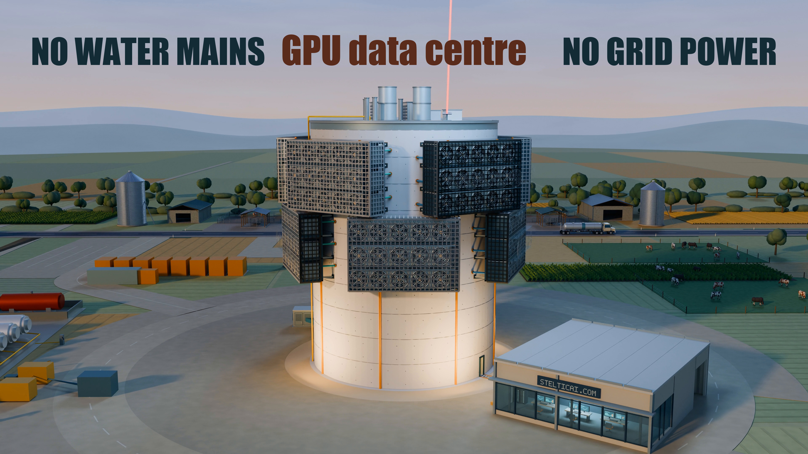

# GPU Silo

**[Watch or download the 4K film](https://github.com/Steltic/gpu_silo/releases/download/gpu-silo-2026-11-25/gpu_silo.mp4)** · 3 min 00.5 s · [English captions](https://github.com/Steltic/gpu_silo/releases/download/gpu-silo-2026-11-25/gpu_silo.srt) · [Chapter guide](docs/sequence.md)

**[Download the complete IFC4 model](https://github.com/Steltic/gpu_silo/releases/download/gpu-silo-2026-11-25/GPU_Silo.ifc)** · [Design report and check register](design/report.md#2-register-of-design-checks) · [Electrical design](design/electrical.md)

The GPU Silo is a concept for a data centre on a rural or regional site without mains water or a grid connection. A 32 m double-walled concrete tower holds 256 NVIDIA Vera Rubin NVL72 racks, or 18,432 installed GPUs. The design assigns about 0.2 acres to the silo footprint. The fuel tanks, roads and service areas require additional land.

Two 25 MW propane turbines supply the site. At rated output, a 4 MW allowance for plant leaves 46 MW for computing. One operating case runs 235 racks at full power and holds 21 spare. Operators can choose another mix within the available power and cooling. Four diesel generators cover emergencies. [Operating assumptions](design/assumptions.md#operating-choice-after-revision-j)

The 64 four-rack pods draw coolant from the lower layer of a 6.52 million litre store between the walls and return heat to the upper layer. Thirty dry coolers reject that heat to air. The store uses water with 25% propylene glycol by volume. The programme allows 278 tanker deliveries for the initial fill. [Cooling and tanker calculations](design/calcs.md)

## Design at a glance

| Revision K design basis | Value |
| --- | ---: |
| GPU racks | 256 × NVIDIA Vera Rubin NVL72, 195 kW each |
| 4SU pods | 64, eight per level on eight levels, 2.77 m apart vertically. Each is 7.16 m long and 8.93 t: 5 m of racks at the shaft end and a 2.16 m CDU and pump section out to the wall. |
| Pod structure | Two welded side trusses, HSS6×3×3/16 chords and HSS2×2×3/16 web, cantilevering from the shaft. Tip deflection 4.9 mm against a 5 mm limit. [Design report](design/report.md) |
| Central shaft | 1.16 m diameter steel tube with a 2 in (50.8 mm) wall, fixed to the foundation and held at its top by the support rig under the diesel level, through 16 plates cast into the inner wall. The levels turn on it. 0.62 m of access round it. |
| CDUs and CDU pumps | 64 + 64, one of each per pod |
| Installed rack heat / normal IT ceiling | 50 MW / 46 MW |
| Silo | 25 m outside, 17 m inside, 32 m high. Outer wall 400 mm with stainless steel hoop bars, inner wall 500 mm, no post-tensioning. |
| Water-glycol store | 6,524 m³ (1.72 M US gal) between the walls. It runs layered, cool below warm, through a pair of vertical pipes for each bay of pods and each cooler frame: about 76 minutes from a fully charged store at the 51.25 MW thermal design load. [Check 5](design/report.md#9-check-5-heat-balance-of-the-store) |
| Dry coolers | 30 × 2 MW in 10 screened steel frames, one pump each. The full cluster and pumps require at least 26 at rated conditions. Inlet temperature determines the available duty. |
| Power | 2 × 25 MW turbines supply normal operations, with a 4 MW plant allowance. The modeled 6 MW intertie is optional for normal operation. Emergency transfer can supply up to 7 MW of priority IT after essential services. |
| Backup | 4 × 2.5 MW diesel sets on the level below, day tanks inside, 64 m³ bulk tank outside |
| Fuel | 8 propane tanks of 20 m, 913 m³, about 43 h at full load, one 200 mm line |
| Roof | 2 turbine exhaust stacks, 2 air inlet houses, diesel exhausts and room vents |
| Trucking | 32 pod trucks at 2 pods each, 278 water tankers, 30 cooler trucks, 26 propane transports, 250 mixers for the walls |
| Store liner | 2 mm spray-applied polyurea on both faces of the store, 4,448 m², sprayed from four stages on days 11 to 14 |
| Programme | Walls in 10 daily lifts by a crew of 22 while the pod cage is built beside them a level a day, then 28 days to handover. The support rig is set on days 4 and 5 to hold the top of the shaft before the first pod. Water goes in last, on days 15 to 28. Commissioning is by others after day 28. |

Section 2 of the design report lists each numbered check and its status. Revision K checks the support rig, sliding shaft guide and both sets of wall mounts, including the revised anchor bars in the IFC. Edit `design_checks.register` in the project inputs to add a check or change its status, then regenerate the report. [Register of design checks](design/report.md#2-register-of-design-checks) · [Project inputs](design/project.json) · [Assumptions and release evidence](design/assumptions.md)

## Explore or contribute

The [project inputs](design/project.json) drive the [calculations](design/calcs.md), [design report](design/report.md), IFC export and parametric model. The [design index](design/README.md) points to each subsystem, and the [decision log](design/history.md) records changes and their reasons. The report identifies the site and vendor data needed for engineering review.

To propose a change, open a [design idea](https://github.com/Steltic/gpu_silo/issues/new/choose) or follow the [contributor guide](CONTRIBUTING.md). The [film production notes](design/technical_short.md) cover the component cutaways, equipment references and how to reproduce the final edit.

## Reuse

The project’s original code, engineering inputs, calculations, drawings, IFC and 3D models, documentation, film, captions and artwork are dedicated to the public domain under **CC0 1.0 Universal**, to the fullest extent permitted by law. You can copy the design, adapt it, build from it, use it commercially and keep your changes private. You owe no attribution, royalties or share-back under CC0. [Full dedication](LICENSE) · [CC0 summary](https://creativecommons.org/publicdomain/zero/1.0/)

Third-party software, equipment documentation and other third-party material retain their own terms. Patent and trademark rights fall outside CC0. The [design report](design/report.md) identifies the engineering checks and assumptions that still need site or supplier verification.
