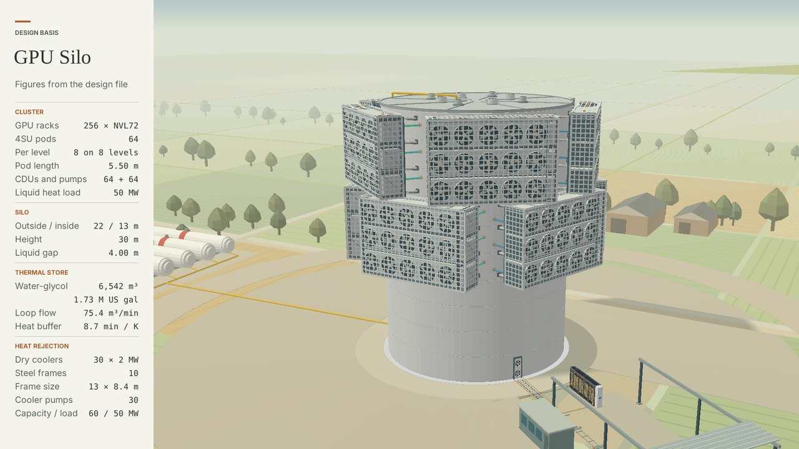

# GPU Silo

**[Watch the animation · MP4](../../releases/latest/download/GPU_Silo.mp4)** · [Animated 3D model · GLB](../../releases/latest/download/GPU_Silo.glb) · [All versions](../../releases)

A 30 m concrete silo that houses, powers and liquid-cools 256 NVIDIA Vera Rubin GPU racks, a 50 MW cluster. The racks sit four to a pod in 64 **4SU** pods on eight levels around a central shaft. Each pod carries its own CDU and pump and plugs into a water-glycol store held between the silo's two concrete walls. Thirty 2 MW dry coolers on ten screened steel frames hang on the outside of the wall and reject the heat. Two 25 MW gas turbine modules sit above the pods under the lid, burn propane from eight tanks beside the silo and feed the pods down the central shaft. A fan plug in the ground door and four roof vents let air rise through the bore.

The animation is the working drawing for this project. Design decisions are made by looking at it, and every dimension in it comes from one file, [design/project.json](design/project.json). The repository holds that file, the [calculations](design/calcs.md) generated from it, the [decisions](design/README.md) and the code that turns them into the film. Anyone can propose a design idea and see it rendered.

| Design basis | Value |
| --- | ---: |
| GPU racks | 256 × NVIDIA Vera Rubin NVL72, 195 kW each |
| 4SU pods | 64, eight per level on eight levels, 5.5 m long, 2.8 m apart vertically |
| CDUs and CDU pumps | 64 + 64, one of each per pod |
| Liquid heat load | 50 MW |
| Silo | 22 m outside, 13 m inside, 30 m high |
| Water-glycol store | 6,542 m³ (1.73 M US gal) between the walls, filled to the top under a lid |
| Dry coolers | 30 × 2 MW in 10 screened steel frames, one pump each. 25 carry the load, 5 are spare. |
| Power | 2 × 25 MW aeroderivative gas turbine modules |
| Fuel | 8 propane tanks of 20 m, 913 m³, about 43 h at full load |
| Bore ventilation | Fan plug in the ground door, 4 roof air vents |

These figures are written by `python -m gpu_silo calcs` and also appear on screen throughout the film. The [calculations](design/calcs.md#8-open-questions-raised-by-these-numbers) list the open questions they raise. The largest are the air and exhaust for two 25 MW turbines inside the silo and the size of a real turbine package.

### Find it in the movie

| Scene | Time |
| --- | ---: |
| Jumpform the double-wall shell and cast the pod sleeves, frame anchors and conduits | 0:00 |
| Two crawlers lower the steel pod cage | 0:25 |
| Water-glycol fills the wall gap to the top | 0:40 |
| A flatbed delivers three 4SU pods with their light-grey CDU and pump sections | 0:47 |
| Lift the first 4SU | 1:01 |
| The retained crawler hangs the ten screened cooler frames while the pods load | 1:09 |
| Run the lower six levels at 3× | 1:30 |
| Lower two power modules, raise four exhaust vents and close the lid | 1:52 |
| Crews ride the wedge platforms to the pods | 2:21 |
| The side of the lower power module folds down to show its 25 MW gas turbine | 2:38 |
| Finished silo: fan plug in the ground door and four roof air vents | 2:53 |
| Design basis and a full exterior orbit | 3:03 |
| Eight propane tanks and the gas line to the power modules | 3:23 |
| Plan view of the cooling loop, with narration | 3:40 |
| Section showing power, water-glycol, gas and air | 4:14 |
| Replace a faulty 4SU on Level 6 | 4:40 |
| Wide shot: the crawler lowers cooler frame 09, swaps one cooler and hangs it back | 4:54 |

[Scene guide](docs/sequence.md)

### Propose a design idea

1. **Describe it.** Open a [design idea](../../issues/new/choose) and say what a viewer should see and why.
2. **Or try it.** Edit a value in [design/project.json](design/project.json), run `python -m gpu_silo calcs` and open a pull request. The render check builds the MP4 and GLB for review.
3. **Record it.** An accepted change adds a line to the [decision log](design/history.md).

[Contributor quick start](CONTRIBUTING.md) · [Design decisions](design/README.md) · [Design calculations](design/calcs.md) · [Decision log](design/history.md)

### What is in the repository

| Path | Contents |
| --- | --- |
| [design/project.json](design/project.json) | Every design input: cluster, silo, pod, store, coolers, power, ventilation, fuel, installation and film |
| [design/calcs.md](design/calcs.md) | The cooling design: heat load, store, flows, coolers and spares. Also power, fuel and bore ventilation. Generated from the inputs. |
| [design/narration.json](design/narration.json) · [audio/](audio) | The narration script and its recording |
| [design/README.md](design/README.md) | The current decision for each part of the design and where to change it |
| [design/history.md](design/history.md) | Dated decision log, including what each decision replaced |
| [gpu_silo/](gpu_silo) | Parametric model, animation and checks |
| [renderer/](renderer) | Film renderer and the on-screen design panels |
| [docs/sequence.md](docs/sequence.md) | Scene-by-scene guide to the film |

This is a concept study. The model checks geometry and motion. It is not a structural, hydraulic, thermal or electrical design.
