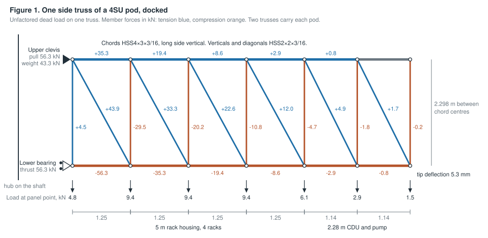
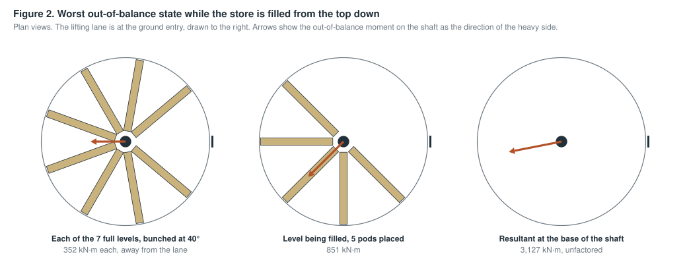
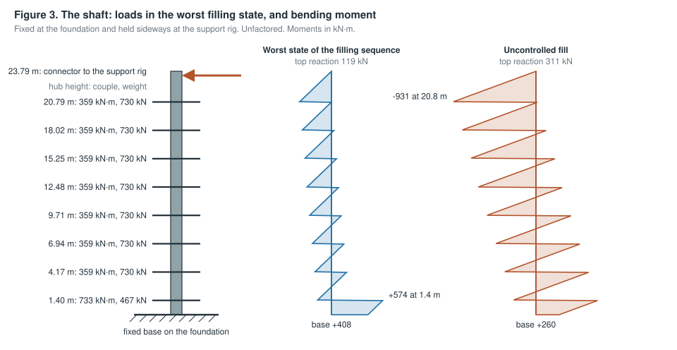
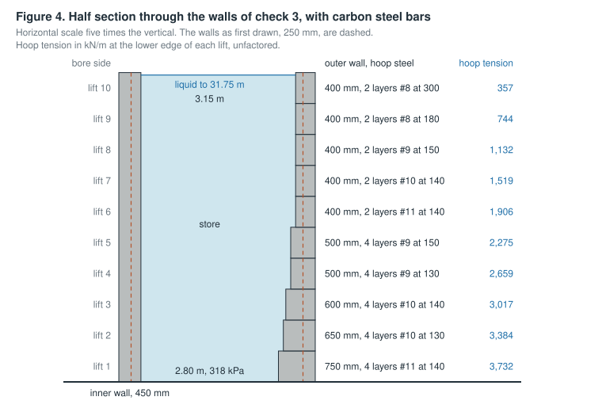
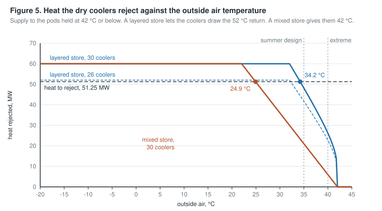
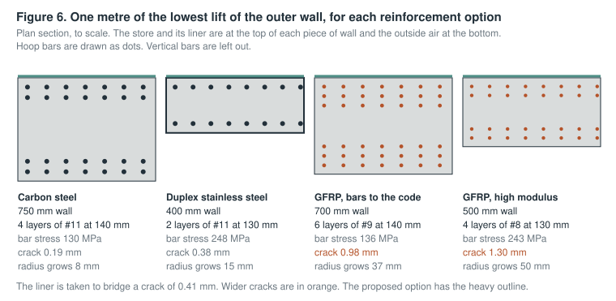
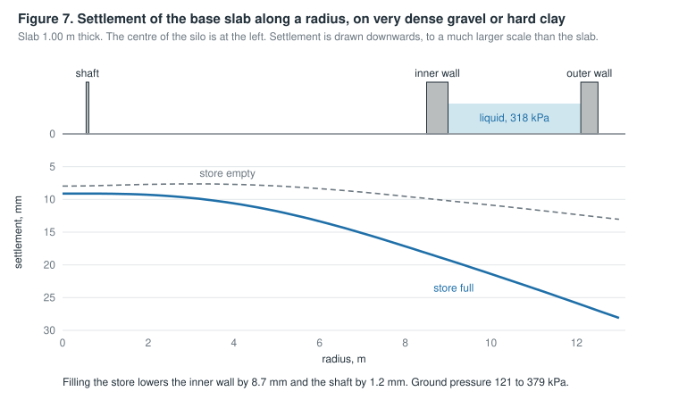
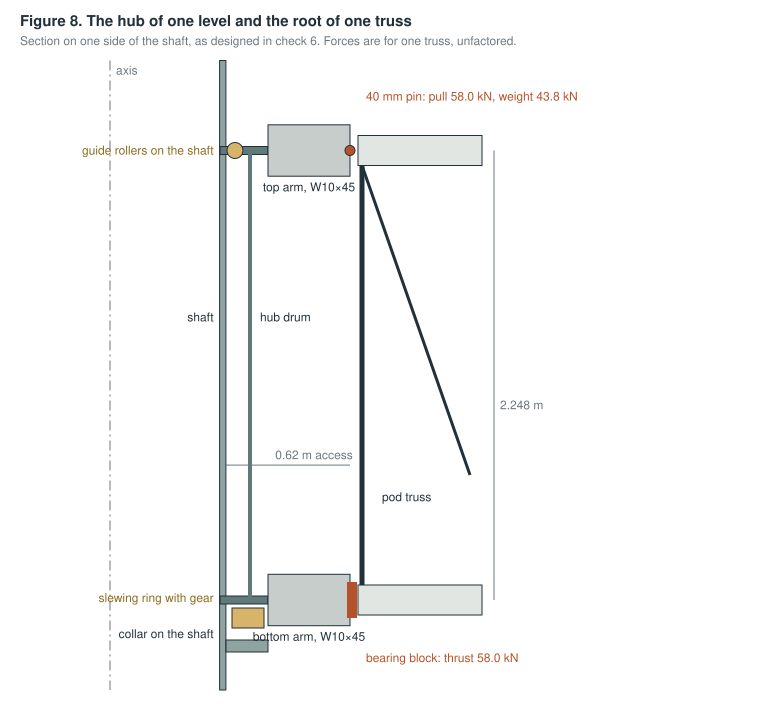

# GPU Silo: structural design report

| | |
| --- | --- |
| Document | GS-STR-001 |
| Revision | K, 2026-11-23 |
| Status | Preliminary, issued for review. Not checked. Not for construction. |
| Prepared by | Revisions A–I by Claude (Anthropic), revisions J–K by Codex for Steltic |
| Checked by | Not yet checked |
| Approved by | Not yet approved |

| Revision | Date | Changes |
| --- | --- | --- |
| A | 2026-11-21 | First issue. Register of checks, basis of design, pod truss, loads on the shaft. |
| B | 2026-11-22 | Access round the shaft widened from 0.50 m to 0.62 m. Truss limit changed from span/1,000 to 5 mm. Shaft confirmed as fixed, with the levels turning on it, and held at its top by the support rig. Check 1 carried out. Checks 7, 8 and 9 added. |
| C | 2026-11-22 | Limits on tip movement set by the project: 5 mm from any one part and 10 mm accumulated. Support rig steel set straight after the cage, generator sets landed on it later. Turbine level given its own mounts and cast-in anchors, as check 10. |
| D | 2026-11-22 | Check 3 carried out for the liquid load: walls without post-tensioning, in 50 MPa concrete, with the liner as the liquid barrier. Thicknesses proposed, not yet adopted in the model. |
| E | 2026-11-22 | Check 5 carried out, first pass: the store has to be layered. Inner wall raised to 500 mm for creep in warm concrete. Reinforcement of the outer wall compared: stainless steel proposed, which makes the outer wall 400 mm throughout. |
| F | 2026-11-22 | Decisions of the project adopted: outer wall 400 mm with stainless steel bars, inner wall 500 mm, the store layered, the CDU with a heat exchanger, and the assumed range of outside air. The store pipes, the cover and the overflow are in the model. |
| G | 2026-11-22 | Check 4 carried out on assumed ground: the slab as drawn is adequate, the shaft base is designed to stand alone, and the fill settles the walls against the shaft. Check 6 carried out, first pass: root connection, hub, bearings and drive. Allowance for the hub raised to 4 t. A thicker shaft wall proposed for the accumulated limit. |
| H | 2026-11-22 | Check 4 corrected. The springs of revision G were values for a small test plate and were about ten times too stiff for soil under a slab this wide. The grounds are now set by modulus: settlement on soil is tens of millimetres, the fill lowers the walls 3 mm against the shaft on dense sand or stiff clay, and the slab as drawn is not strong enough on dense sand or stiff clay. |
| I | 2026-11-22 | Decisions of the project adopted: shaft wall 2 in, base slab 2 m on ground taken as dense sand or stiff clay, a flexible section in each wall connection, and the hub arrangement of check 6. The build is not to be constrained: the wall connections are not left until after the fill, and the order of loading stays free. The model draws the hub drum, beam arms at the pod roots and the flexible sections. |
| J | 2026-11-22 | Crown floor girders, sliding shaft guide, separate anchor groups, reference lateral and services envelopes, recorded owner assumptions and the operating IFC. |
| K | 2026-11-23 | Checks 7–10 verified on the revision J loading basis. Added erection combinations, directional guide play, individual stud and closure weld checks, and revised the crown anchor bars for clearance and development. |

This report is generated from [project.json](project.json) by `python -m gpu_silo calcs`. Section 2 reads the numbered checks from `design_checks.register`. Sections 7.5–7.8 use the [coordination calculations](../gpu_silo/completion.py) and the [crown anchorage detail](../gpu_silo/crown_detail.py).

## Contents

1. [Purpose and scope](#1-purpose-and-scope)
2. [Register of design checks](#2-register-of-design-checks)
3. [Basis of design](#3-basis-of-design)
4. [Check 2: pod truss](#4-check-2-pod-truss)
5. [Check 1: central shaft](#5-check-1-central-shaft)
6. [Check 6: root connection and level drive, design loads](#6-check-6-root-connection-and-level-drive-design-loads)
7. [Checks 7 to 10: support rig, shaft connector and wall mounts, design loads](#7-checks-7-to-10-support-rig-shaft-connector-and-wall-mounts-design-loads)
8. [Check 3: silo walls](#8-check-3-silo-walls)
9. [Check 5: heat balance of the store](#9-check-5-heat-balance-of-the-store)
10. [Reinforcement of the outer wall: options](#10-reinforcement-of-the-outer-wall-options)
11. [Check 4: foundation](#11-check-4-foundation)
12. [Check 6: root connection, hub and level drive](#12-check-6-root-connection-hub-and-level-drive)
13. [Assumptions and release conditions](#13-assumptions-and-release-conditions)
14. [Appendix A: member forces in the pod truss](#appendix-a-member-forces-in-the-pod-truss)
15. [Appendix B: section properties](#appendix-b-section-properties)

## 1. Purpose and scope

The GPU Silo stores 64 4SU pods on 8 levels round a central steel shaft, inside a double-walled concrete silo. Each pod holds 4 GPU racks with its own coolant distribution unit (CDU) and pump. The purpose of this report is to give confidence in the predicted performance of the structure by working through a fixed list of design checks, one at a time, and recording the basis, the method and the result of each.

This revision covers:

- the register of design checks and the basis of design;
- check 2, the pod trusses, sized for gravity load;
- check 1, the central shaft, sized for gravity load;
- the loads at the pod root and the rotating mass of a level, for check 6;
- the loads on the support rig, the shaft connector and the wall mounts of both power levels, for checks 7 to 10;
- check 3, the silo walls, for the liquid load;
- check 5, the heat balance of the store, as a first pass;
- a comparison of reinforcement for the outer wall, using the temperatures from check 5;
- check 4, the base slab and the anchorage of the shaft, on assumed ground;
- check 6, the root connection of a pod, the hub of a level and its drive, as a first pass.

Section 7.8 screens lateral loading against a stated reference envelope. Site-specific dynamic and geotechnical verification requires an identified site.

## 2. Register of design checks

| No. | Check | Scope | Status | Where |
| ---: | --- | --- | --- | --- |
| 1 | Steel shaft | Axial load, out-of-balance bending, shortening and lean of the central shaft, fixed at its base and held at its top | Wall thickness 2 in, set by the project after check 6. For review. | [Section 5](#5-check-1-central-shaft) |
| 2 | Pod trusses | The two welded side trusses that carry each 4SU pod as a cantilever | Sized for gravity load to a 5 mm tip deflection. For review. | [Section 4](#4-check-2-pod-truss) |
| 3 | Silo wall thickness | Hoop tension in the outer wall, external pressure on the inner wall, wall thickness and reinforcement, without post-tensioning | Adopted for liquid load and temperature: outer wall 400 mm with stainless steel bars, inner wall 500 mm. For review. | [Section 8](#8-check-3-silo-walls) |
| 4 | Foundation | Base slab, bearing pressure, and the anchorage of the shaft base | Slab 2.0 m on dense sand or stiff clay, adopted. Shaft base designed. For review. The ground is not known. | [Section 11](#11-check-4-foundation) |
| 5 | Heat balance of the store | Water-glycol temperatures, mixing and ride-through in the store | First pass complete. The store is layered: pipes, cover and overflow are in the model. For review. | [Section 9](#9-check-5-heat-balance-of-the-store) |
| 6 | Pod-to-shaft connection and level drive | Root connection of the pod, the hub at each level, and the capacity of the drive that turns a level on the fixed shaft | First pass: root connection, hub, bearings and drive sized. Arrangement adopted. For review. | [Section 12](#12-check-6-root-connection-hub-and-level-drive) |
| 7 | Top support rig | The steel rig at the crown that carries the diesel generator sets and holds the top of the shaft. Set on its mounts straight after the cage. | Rail and open ring checked for bare, partial and full equipment loading on the revision J basis. Supplier skid reactions and vibration review pending. | [Section 7](#7-checks-7-to-10-support-rig-shaft-connector-and-wall-mounts-design-loads) |
| 8 | Shaft-top connector | The connector that puts the horizontal force from the top of the shaft into the support rig | Four-arm guide checked for directional clearance, stiffness, pad bearing and free stroke. Installed pad properties, play and sliding action need verification. | [Section 7](#7-checks-7-to-10-support-rig-shaft-connector-and-wall-mounts-design-loads) |
| 9 | Cast-in wall mounts | The mounts cast into the inner wall that carry the support rig, and the wall locally | Rig seat reactions, stud-row demand, key and anchor-bar detailing checked on the assumed wall. Cracked-concrete load transfer and joint detail require independent review. | [Section 7](#7-checks-7-to-10-support-rig-shaft-connector-and-wall-mounts-design-loads) |
| 10 | Turbine level mounts and cast-in anchors | The turbine level's own mounts and the anchors cast into the inner wall for them | Independent turbine floor and its anchor groups checked for staged loading. Machine dynamics and local wall anchorage require verification. | [Section 7](#7-checks-7-to-10-support-rig-shaft-connector-and-wall-mounts-design-loads) |

## 3. Basis of design

### 3.1 Codes and standards

| Subject | Document |
| --- | --- |
| Structural steel | ANSI/AISC 360-22, *Specification for Structural Steel Buildings*, load and resistance factor design (LRFD) |
| Loads and combinations | ASCE/SEI 7-22, *Minimum Design Loads and Associated Criteria for Buildings and Other Structures* |
| Hollow sections | ASTM A500/A500M, Grade C |
| Plate for the shaft | ASTM A572/A572M, Grade 50 |
| Liquid-containing concrete | ACI 350-06, *Code Requirements for Environmental Engineering Concrete Structures*, to be confirmed against ACI 350-20 |
| Structural concrete | ACI 318-19, *Building Code Requirements for Structural Concrete* |
| Reinforcing bar | ASTM A615/A615M, Grade 60 |
| Crack width | ACI 224.2R, *Cracking of Concrete Members in Direct Tension*, and ACI 224R-01, *Control of Cracking in Concrete Structures* |
| Stainless reinforcing bar | ASTM A955/A955M, Grade 75 |
| Glass FRP reinforcement | ACI CODE-440.11-22 with bars to ASTM D7957/D7957M |
| Creep of warm concrete | fib *Model Code for Concrete Structures 2010* |
| Crack bridging of the liner | EN 1062-7 |
| Section dimensions | AISC *Steel Construction Manual*, 16th edition, Table 1-11 and Table 1-12 |

The pods and the shaft are equipment supports inside a structure, and the specification is applied to them as it would be to a building frame. A crane or machinery standard may also apply to the hoisting and the rotation. That is to be settled under check 6.

### 3.2 Materials

| Property | Value | Source |
| --- | ---: | --- |
| Hollow structural sections | ASTM A500 Grade C | |
| Yield stress of hollow sections, Fy | 345 MPa (50 ksi) | ASTM A500 Grade C, shaped sections |
| Tensile strength of hollow sections, Fu | 427 MPa (62 ksi) | ASTM A500 Grade C |
| Design wall thickness of hollow sections | 0.93 × nominal | AISC 360-22 Section B4.2, for A500 sections |
| Shaft | ASTM A572 Grade 50 plate, rolled and seam welded | |
| Yield stress of the shaft plate, Fy | 345 MPa (50 ksi) | ASTM A572 Grade 50 |
| Design wall thickness of the shaft | nominal | plate, submerged-arc welded |
| Modulus of elasticity, E | 200 GPa (29,000 ksi) | AISC 360-22 |
| Density | 7,850 kg/m³ | |

### 3.3 Units

Quantities are in SI units: metres, millimetres, kilonewtons and tonnes. Steel sections and plate keep their US sizes in inches. 1 kip = 4.448 kN and 1 in = 25.4 mm.

### 3.4 Geometry

| Quantity | Value | Basis |
| --- | ---: | --- |
| Clear bore of the silo | 17 m diameter | input |
| Shaft | 1.16 m outside diameter | input |
| Access round the shaft | 0.62 m | input, revision B |
| Pod root radius | 1.20 m | shaft radius + access |
| Rack housing | 5 m long, 0.6 m wide, 2.3 m high | input |
| CDU and pump section | 2.16 m long | fills the pod out to 140 mm from the wall |
| Pod length, the cantilever span L | 7.16 m | |
| Pod tip radius | 8.36 m | |
| Frame envelope | 0.76 m wide, 2.40 m high | 80 mm each side of the racks for a chord |
| Levels | 8 at 2.77 m, 8 pods a level | input |
| Storage pitch and packed pitch | 45° and 40° | input |
| Shaft, from the foundation to the support rig | 23.79 m | the connector is at mid-depth of the rig |

**Clearance at the pod roots.** The pods come closest to each other at their roots. With 0.62 m of access the frames are 107 mm apart there when a level is bunched at 40°, and a pod being lifted passes the pods either side of the lifting lane with 100 mm to spare. Stored at 45° the frames are 216 mm apart at the roots, so the space round the shaft is an inspection space and there is no way through at pod level to the wedge between two pods.

### 3.5 Loads

Dead load, D, is the only load in this revision. Fixed equipment and its liquid contents are taken as dead load, as ASCE 7-22 Chapter 3 provides.

| Item | Mass | Distribution | Status |
| --- | ---: | --- | --- |
| GPU racks | 4 × 1.6 t = 6.4 t | each rack on the two panel points of its bay | allowance. No shipping or operating weight is published for the Vera Rubin NVL72. |
| CDU and pump | 0.6 t | uniform over the CDU and pump section | allowance |
| Coolant and piping | 0.4 t | uniform over the pod | allowance |
| Truss steel | calculated | at the nodes of each member | from the design |
| Cross members and plan bracing | calculated | uniform over the pod | HSS2×2×3/16, one top and one bottom at each panel point, and a plan diagonal in each panel, top and bottom |
| Connections | 10% of the steel | with the steel | allowance |
| Housing | 10 kg/m² of rack housing and CDU enclosure | uniform over the pod | allowance |
| Hub, bearing and access floor | 4 t a level | at each hub | allowance, to be replaced under check 6 |
| Shaft | calculated | uniform | from the design |
| Power and data services inside the shaft | 300 kg/m | uniform | allowance |

### 3.6 Load combinations

| Case | Combination | Basis |
| --- | --- | --- |
| Strength | 1.4 D | ASCE 7-22 Section 2.3.1, combination 1 |
| Strength, pod hoisted | 1.4 × 1.25 D | the same, with a 25% allowance for vertical impact, as ASCE 7-22 Section 4.9.3 gives for a powered bridge crane |
| Deflection and movement | 1.0 D | |

### 3.7 Serviceability

The tip of each pod carries the coupling that connects its CDU to the water-glycol store through a sleeve in the inner wall, so the vertical position of the tip matters. The project set two limits on its movement for revision C.

| Criterion | Limit |
| --- | ---: |
| Movement of a pod tip caused by any one part of the structure on its own | 5 mm |
| Movement of a pod tip accumulated over all the parts | 10 mm |

Where the accumulated limit stands with the parts designed so far:

| Part | Tip movement, mm | Single limit, mm | Where |
| --- | ---: | ---: | --- |
| Pod truss, deflection under dead load | 4.90 | 5 | section 4.5 |
| Shaft, shortening as the store is filled plus lean in the worst filling state | 3.05 | 5 | section 5.7 |
| Root connection, as designed | 0.33, with an allowance of 0.6 | 5 | section 12.5 |
| Tilt of the hub on its bearings | allowance of 1 | 5 | section 12.7 |

The truss is the lightest that meets its own 5 mm. The shaft wall was first the lightest that met the shaft's own 5 mm, 1-1/4 in, which left 0.4 mm of the accumulated limit for the root connection and the hub. Check 6 found that they need 1.6 mm. The project therefore set the shaft wall at 2 in, in revision I. Section 12.9 has the comparison of shaft walls.

| | mm |
| --- | ---: |
| Truss, shaft, root connection and tilt of the hub | **9.54** |
| Limit | 10 |

### 3.8 The wall connection

Each pod is joined to its sleeve in the inner wall through **a section of flexible material**, by decision of the project in revision I. It takes up the movement between the pod, which hangs from the shaft, and the wall. Nothing in the build has to wait for the store to be filled, and the order in which pods are loaded is free.

| Movement of the pod tip against its sleeve | mm | Where |
| --- | ---: | --- |
| *Tip lower than the sleeve* | | |
| Structure: truss, shaft, root connection and hub | 9.5 | section 12.9, limit 10 mm |
| Inner wall warms and rises before the shaft does | 5.4 | section 9.13, top level |
| Sum | **15.0** | |
| *Tip higher than the sleeve* | | |
| Filling the store settles the wall more than the shaft | 2.7 | section 11.5 |
| Settlement over time | 10.0 | allowance until the ground is known |
| Sum | **12.7** | |
| *Gap closes* | | |
| Inner wall squeezed by the liquid, with creep | 5.2 | section 9.13, lowest level |
| Pod lengthens as it warms | 1.5 | section 9.13 |
| Sum | **6.7** | |
| *Gap opens* | | |
| Bore widens as the wall warms | 2.2 | section 9.13 |
| Sum | **2.2** | |

| Requirement on the flexible section | Value | Basis |
| --- | ---: | --- |
| **Movement across the connection, up or down** | **± 25 mm** | the larger sum above, times 1.5 |
| **Movement along the connection** | **± 15 mm** | the same |
| Flexible length needed | about 300 mm | hose makers' rule for a sideways offset, with a bending radius of 600 mm. To be confirmed by a supplier. |
| Gap between the pod tip and the wall | 140 mm | so the flexible length runs back into the end of the pod, behind the plug |
| Liquid | 52 °C, 304 kPa of head at the lowest level, and the pressure of the pump | |

The limits of 5 mm and 10 mm in section 3.7 still apply to the structure. Settlement and temperature are outside them and are taken by the flexible section. The power and data connections of a pod pass through the shaft, not the wall, and are not affected.

## 4. Check 2: pod truss

### 4.1 Description

Each pod is carried by two vertical trusses, one each side of the racks, 0.68 m apart centre to centre. They are joined top and bottom at every panel point by cross members and plan bracing, so the pair acts as a box. The trusses are 2.40 m deep overall and span 7.16 m as cantilevers from the hub on the shaft.

- **Chords.** Rectangular hollow sections with the long side vertical, no wider than 3 in (76 mm) so that they fit in the 80 mm beside the racks. An I-section was considered. No rolled W-shape has a flange narrower than about 100 mm, so an I-section chord would widen the pod, and a hollow section also gives a flat face to weld the web members to.
- **Web.** Square hollow sections. There is a vertical at every panel point and one diagonal in each panel. The diagonals fall towards the tip, so they are in tension when the pod is docked and the shorter verticals take the compression.
- **Panels.** One panel to each rack, 1.25 m long, so that each rack bears on panel points. The CDU and pump section has 2 panels of 1.08 m.
- **Joints.** Fully welded.
- **Support.** At the root the top chord is held by a clevis that takes the pull and the whole weight. The bottom chord bears on the hub and takes thrust only.

### 4.2 Design criteria

| No. | Criterion | Limit | Basis |
| ---: | --- | --- | --- |
| 1 | Tip deflection under dead load | 5 mm | section 3.7, limit for one part |
| 2 | Member strength | required strength ≤ design strength | AISC 360-22 Chapters D and E |
| 3 | Member slenderness | Lc/r ≤ 200 for every member | AISC 360-22 Section E2, user note. Applied to all members because the web forces reverse when the pod is hoisted. |
| 4 | Wall slenderness | (b − 3t)/t ≤ 1.40 √(E/Fy) = 33.7 | AISC 360-22 Table B4.1a, case 6. No slender walls. |
| 5 | Joint geometry | web width between 0.25 and 1.0 of the chord width | AISC 360-22 Chapter K, limits of applicability |
| 6 | Chord width | ≤ 3 in | the frame envelope |

The lightest pair of sections from the lists in the design file that meets all six is chosen. The lists hold 11 chord sizes from HSS4×3×3/16 to HSS8×3×3/8 and 7 web sizes from HSS2×2×3/16 to HSS3×3×5/16, none with a wall thinner than 3/16 in.

### 4.3 Analysis

Each truss is analysed as a pin-jointed plane truss by the direct stiffness method, with half the pod's load applied at its panel points. Member lengths are taken between the centre lines of the chords, 2.248 m apart. The welded joints make the real truss slightly stiffer than the model, so the calculated deflection is an upper estimate for the truss alone.

Two support cases are analysed:

1. **Docked.** A cantilever from the root, as in Figure 1.
2. **Hoisted.** Hanging from the hoist's two pickups on the top chord, at panel points 1 and 4, which are 1.25 m and 5.00 m from the root. The pickups carry 47.2 kN and 40.4 kN for the whole pod, unfactored.

Compression members are checked for flexural buckling with an effective length equal to the distance between panel points.

### 4.4 Selected sections

| Member | Section | Size, mm | Steel |
| --- | --- | --- | --- |
| Top and bottom chords | **HSS6×3×3/16**, long side vertical | 152 deep × 76 wide × 4.8 wall | ASTM A500 Grade C |
| Verticals and diagonals | **HSS2×2×3/16** | 51 × 51 × 4.8 wall | ASTM A500 Grade C |
| Cross members and plan bracing | HSS2×2×3/16 | 51 × 51 × 4.8 wall | ASTM A500 Grade C |

### 4.5 Deflection

| Quantity | Value |
| --- | ---: |
| Tip deflection under dead load, stiffness analysis | **4.90 mm** |
| As a fraction of the span | span/1,463 |
| Limit | 5.00 mm |
| Tip deflection by statics and virtual work (section 4.7) | 4.90 mm |
| **Result** | **Satisfied**, 98% of the limit |

The 5 mm limit governs the chords. The lightest sections in the list, HSS4×3×3/16 chords with HSS2×2×3/16 web members, deflect 5.26 mm and do not pass. The verticals and diagonals contribute 3.3 mm of the deflection of the selected truss and the chords 1.6 mm, because the truss is 0.34 of its span deep.

### 4.6 Strength

Required strengths are the larger of the docked and hoisted cases with the factors in section 3.6. Design strengths are φtFyAg in tension (Section D2, φt = 0.90) and φcFcrAg in compression (Section E3, φc = 0.90). Tensile rupture does not govern for members welded all round, because 0.75 Fu exceeds 0.90 Fy for this steel.

| Member group | Section | Tension, kN | Design tension strength, kN | Compression, kN | Longest, m | Lc/r | Design compression strength, kN | Highest ratio |
| --- | --- | ---: | ---: | ---: | ---: | ---: | ---: | ---: |
| Top chord | HSS6×3×3/16 | 50.9 | 588.7 | 4.4 | 1.25 | 40 | 525.1 | 0.09 |
| Bottom chord | HSS6×3×3/16 | 4.4 | 588.7 | 81.2 | 1.25 | 40 | 525.1 | 0.15 |
| Diagonal | HSS2×2×3/16 | 62.5 | 239.4 | 19.2 | 2.57 | 138 | 62.8 | 0.31 |
| Vertical | HSS2×2×3/16 | 26.9 | 239.4 | 41.9 | 2.25 | 121 | 82.3 | 0.51 |

The most heavily used member is the vertical at panel point 1, at 0.51. Strength does not govern. Forces in each member are in Appendix A.

### 4.7 Verification

The stiffness analysis is checked in three ways each time the report is generated. The checks are in [structure.py](../gpu_silo/structure.py) and the build fails if one does not hold.

| Check | Stiffness analysis | Independent value | Agreement |
| --- | ---: | ---: | --- |
| Tip deflection, by method of sections and virtual work | 4.895 mm | 4.895 mm | within 0.00% |
| Vertical reaction of one truss against half the pod weight | 43.79 kN | 43.79 kN | equal |
| Root couple of one truss against half the root moment | 130.4 kN·m | 130.4 kN·m | equal |

Section properties are calculated from the nominal size, the design wall thickness and an outside corner radius of twice the wall. For HSS6×3×1/4 this gives 3.83 in² and 13.92 lb/ft against 3.84 in² and 13.91 lb/ft in the AISC Manual. The properties of the selected sections are in Appendix B and should be compared with the Manual at the checking stage.

### 4.8 Weight of a pod

| Item | Mass, kg | Basis |
| --- | ---: | --- |
| Two trusses | 855 | HSS6×3×3/16 chords, HSS2×2×3/16 web |
| Cross members and plan bracing | 160 | 24.9 m of HSS2×2×3/16 |
| Connections | 101 | 10% of the steel |
| Housing | 415 | 10 kg/m² |
| **Frame and housing** | **1,531** | |
| Racks | 6,400 | allowance |
| CDU and pump | 600 | allowance |
| Coolant and piping | 400 | allowance |
| **One pod, operating** | **8,931** | 87.6 kN |

Steel is 11% of the weight of a pod. The racks are 72%, so the rack weight is the number that most needs confirming.

### 4.9 Sensitivity to the deflection limit

The table gives the lightest design in the list for other limits, with all the other criteria unchanged.

| Limit, mm | Chords | Web | Tip deflection, mm | As a fraction | Steel a pod, kg | Pod, t |
| ---: | --- | --- | ---: | --- | ---: | ---: |
| 10 | HSS4×3×3/16 | HSS2×2×3/16 | 5.3 | span/1,362 | 914 | 8.82 |
| 7.5 | HSS4×3×3/16 | HSS2×2×3/16 | 5.3 | span/1,362 | 914 | 8.82 |
| 5 | HSS6×3×3/16 | HSS2×2×3/16 | 4.9 | span/1,463 | 1,014 | 8.93 |
| 4 | HSS5×3×3/16 | HSS2-1/2×2-1/2×1/4 | 3.9 | span/1,821 | 1,224 | 9.16 |
| 3.5 | HSS6×3×1/4 | HSS2-1/2×2-1/2×1/4 | 3.4 | span/2,079 | 1,409 | 9.37 |
| 3 | HSS8×3×1/4 | HSS3×3×1/4 | 2.9 | span/2,440 | 1,695 | 9.68 |

### 4.10 Conclusion

HSS6×3×3/16 chords with HSS2×2×3/16 verticals and diagonals carry the pod with a tip deflection of 4.9 mm against the limit of 5 mm, and a highest strength ratio of 0.51. The deflection limit governs. A pod weighs 8.93 t in operation.

The result holds for gravity load only. The items in section 4.11 could change the section sizes, the lateral case most of all, and the design should not be treated as final until they are closed.

### 4.11 Interfaces beyond the plane truss check

Revision J dispositions and release evidence for these interfaces are in the [assumption register](assumptions.md).

1. **Lateral load.** The pair of trusses is only 0.68 m wide and cantilevers 7.16 m sideways as well as downwards. Earthquake load and the starting and stopping of a level act sideways on it. The site and its seismic design category are not yet fixed. This case is likely to govern the chords and the plan bracing.
2. **Welded joints.** The connections between hollow sections are to be designed to AISC 360-22 Chapter K. Only the width ratio is checked here.
3. **Root connection.** The clevis, the bearing and their effect on the tip deflection are part of check 6.
4. **Local loads.** The racks are assumed to bear at panel points through the cross members. Rack feet that land between panel points would bend the bottom chord.
5. **Transport.** The pods travel upright, two side by side on a flatbed. Road loads and tie-down points are not checked.
6. **Fatigue.** The number of lifts and rotations in the life of a pod is small, so fatigue is not expected to govern. This is to be confirmed with the service plan.
7. **Temperature.** The bore is expected to sit near the temperature of the store. Differential movement between the pod and the wall sleeve is not checked.

## 5. Check 1: central shaft

### 5.1 Arrangement

These points were confirmed for revision B.

- The shaft is fixed to the foundation at its base and does not turn. Each level has a hub that turns on the shaft, and the eight pods of a level hang from the hub.
- The base is a heavy fixed connection to the foundation. It is designed with the foundation under check 4, for the reactions in section 5.8.
- The top of the shaft is held sideways by a connector to the support rig that carries the diesel generator sets. The steel of the rig is set on its wall mounts and connected to the shaft straight after the cage is lifted in, before any pod is hung. The generator sets are landed on it later.
- The connector, the rig and the mounts were added in revision B. The rig passes the force to mounts cast into the inner wall. The connector takes sideways force only, so the shaft is free to shorten under load and the weight of the rig does not come onto the shaft.
- The store is filled from the top level down. A pod is lifted up a lane at the ground entry by the hoist under the crown. While it is lifted, every level that is already full closes up from 45° to 40° between pods to open the lane.

The shaft is a round tube of 1160 mm outside diameter, rolled from plate, 23.79 m from the top of the foundation to the connector. Its wall thickness is the result of this check.

### 5.2 Dead load from the pods

| Quantity | Value | Basis |
| --- | ---: | --- |
| Weight of one pod, W | 87.6 kN (8.93 t) | section 4.8 |
| Centre of gravity from the root | 2.98 m | |
| Centre of gravity from the shaft axis | 4.18 m | root radius 1.20 m |
| Moment of one pod at its root | 261 kN·m | |
| Moment of one pod about the shaft axis, Mpod | **366 kN·m** | |
| Weight of one level, 8 pods | 701 kN (71.4 t) | |
| Weight of 64 pods | **5,605 kN (572 t)** | |
| Hub, bearing and access floor | 39 kN a level | allowance |
| Shaft and the services inside it | 394 kN | 1,390 kg/m of steel and 300 kg/m of services |

All values are unfactored.

### 5.3 Out-of-balance moment

A complete level stored at 45° is balanced and puts no moment on the shaft. Moment arises while the store is being filled, and again whenever a pod is exchanged in service, because the levels above the working level bunch to open the lane.

| State | Moment on the shaft | In terms of Mpod |
| --- | ---: | ---: |
| One complete level, stored at 45° | 0 | 0 |
| One complete level, bunched at 40° | 366 kN·m | 1.00 |
| One level part filled, worst number of pods | 956 kN·m | 2.61 |
| **Worst state in the filling sequence, total** | **3,247 kN·m** | **8.87** |
| Every level half filled on the same side, total | 7,651 kN·m | 20.9 |

The worst state in the sequence has 7 levels full and bunched and 5 pods on the level being filled. The moments of the bunched levels all point away from the lifting lane, so they add up the height of the shaft. Figure 2 shows this state. An exchange of a pod on the lowest level in service produces nearly the same state.

The last row is not part of the planned sequence. It is the moment that would arise if the fill order were not controlled.

### 5.4 Design criteria

| No. | Criterion | Limit | Basis |
| ---: | --- | --- | --- |
| 1 | Movement of a pod tip caused by the shaft | 5 mm on its own, and 10 mm accumulated with the truss | section 3.7. Shortening under the full store plus lean in the worst state of the filling sequence. |
| 2 | Strength under axial load and bending | interaction ≤ 1.0 in all three loading states | AISC 360-22 Sections E3, F8 and H1 |
| 3 | Wall slenderness | D/t ≤ 0.11 E/Fy = 63.8 | AISC 360-22 Table B4.1a, case 9. No slender wall in compression. |
| 4 | Member slenderness | Lc/r ≤ 200 | AISC 360-22 Section E2, user note |

Strength is checked for the uncontrolled fill as well as for the planned sequence. This is a decision made in this report so that a mistake in the fill order cannot overload the shaft. It costs nothing, because criterion 1 governs. The movement limit is checked for the planned sequence only.

The thinnest plate in the list in the design file that meets all four is chosen.

The shaft is treated as one part: its shortening and its lean are added before they are compared with the limit for one part.

### 5.5 Analysis

The shaft is analysed as a beam, fixed at the foundation and held in position at the connector, 23.79 m above. The out-of-balance moment of each level is applied as a couple at the height of its hub. Couples are resolved onto the direction of their resultant. The weights of the pods, hubs, shaft and services give the axial force.

- **Shortening.** The drop of a hub is the shortening of the shaft below it under the weight of all 64 pods. The self-weight of the shaft and the hubs is left out, because it is in place before the hubs are set to level.
- **Lean.** The slope of the shaft at a hub tilts the pods of that level. The tip of a pod moves by the slope times the tip radius of 8.36 m. The largest slope at any hub is used.
- **Second-order effects.** Moments are multiplied by B1 = 1/(1 − Pu/Pe1), with Pe1 = π²EI/L² and Cm = 1.0, as AISC 360-22 Appendix 8 allows for a member held against sidesway.
- **Effective length.** K = 0.8, the value recommended for a column fixed at one end and held in position at the other.

### 5.6 Selection of the wall thickness

| Wall, in (mm) | D/t | Mass, kg/m | Shortening, mm | Tip movement from lean, mm | Total, mm | Strength ratio | Result |
| --- | ---: | ---: | ---: | ---: | ---: | ---: | --- |
| 3/4 (19.0) | 60.9 | 536 | 4.55 | 3.16 | 7.72 | 0.58 | Tip movement too large |
| 7/8 (22.2) | 52.2 | 624 | 3.91 | 2.74 | 6.65 | 0.50 | Tip movement too large |
| 1 (25.4) | 45.7 | 711 | 3.43 | 2.41 | 5.85 | 0.43 | Tip movement too large |
| 1-1/8 (28.6) | 40.6 | 797 | 3.06 | 2.16 | 5.22 | 0.38 | Tip movement too large |
| 1-1/4 (31.8) | 36.5 | 883 | 2.76 | 1.96 | 4.73 | 0.35 | Passes |
| 1-3/8 (34.9) | 33.2 | 969 | 2.52 | 1.80 | 4.32 | 0.32 | Passes |
| 1-1/2 (38.1) | 30.4 | 1,054 | 2.32 | 1.66 | 3.98 | 0.29 | Passes |
| 1-3/4 (44.4) | 26.1 | 1,223 | 2.00 | 1.45 | 3.45 | 0.25 | Passes |
| **2 (50.8)** | 22.8 | 1,390 | 1.76 | 1.29 | **3.05** | 0.14 | Selected |

**Selected: 1160 mm outside diameter × 2 in (50.8 mm) wall.** The lightest wall that meets the shaft's own limits is 1-1/4 in, where the movement limit governs. The project set 2 in after check 6, to keep the accumulated movement of a pod tip within 10 mm (section 12.9). Strength would be met by the thinnest plate in the list.

| Property of the selected tube | Value |
| --- | ---: |
| Area | 177,020 mm² |
| Second moment of area | 27.3 × 10⁹ mm⁴ |
| Flexural stiffness, EI | 5.46 GN·m² |
| Radius of gyration | 393 mm |
| Mass | 1,390 kg/m, 33.1 t in all |
| D/t | 22.8, compact in flexure (limit 0.07 E/Fy = 40.6) |

### 5.7 Movement of the pod tips

| Quantity | Value |
| --- | ---: |
| Shortening at the top hub under the full store | 1.76 mm |
| Largest slope of the shaft at a hub, worst state of the filling sequence | 0.154 mrad |
| Tip movement from that slope | 1.29 mm |
| **Total** | **3.05 mm** |
| Limit | 5.00 mm |
| **Result** | **Satisfied**, 61% of the limit |

The two parts are added although they do not peak in exactly the same state, which is on the safe side. The shortening builds up from the bottom of the shaft, so it is largest at the top level, which is also the first to be filled:

| Level | Hub height, m | Drop of the hub under the full store, mm |
| ---: | ---: | ---: |
| 1 | 1.40 | 0.22 |
| 2 | 4.17 | 0.61 |
| 3 | 6.94 | 0.93 |
| 4 | 9.71 | 1.21 |
| 5 | 12.48 | 1.43 |
| 6 | 15.25 | 1.59 |
| 7 | 18.02 | 1.70 |
| 8 | 20.79 | 1.76 |

### 5.8 Strength

| Loading state | Pods | Axial at the base, kN | Pu, kN | Largest moment, kN·m | B1 | Mu, kN·m | Pu/φPn | Mu/φMn | Interaction |
| --- | ---: | ---: | ---: | ---: | ---: | ---: | ---: | ---: | ---: |
| Store complete, every level at the storage pitch | 64 | 6,313 | 8,839 | 0 | 1.10 | 0 | 0.19 | 0.00 | **0.10** |
| Worst state of the filling sequence: 7 levels full and bunched, 5 pods on the next | 61 | 6,051 | 8,471 | 574 | 1.10 | 882 | 0.18 | 0.05 | **0.14** |
| Uncontrolled fill: 4 pods on the same side of every level | 32 | 3,511 | 4,915 | 931 | 1.05 | 1,374 | 0.11 | 0.07 | **0.12** |

| Design strength of the selected tube | Value | Basis |
| --- | ---: | --- |
| Compression, φcPn | 46,282 kN | Section E3, Lc/r = 48, Fcr = 291 MPa |
| Flexure, φbMn | 19,420 kN·m | Section F8, plastic moment |
| Shear, φvVn | 16,489 kN | Section G5, yielding |

Axial force and the largest moment are combined although they occur at different heights. The interaction is by Section H1.1. The largest shear is 435 kN, which is 3% of the design shear strength.

Reactions for the checks that follow:

| Loading state | Vertical at the base, kN | Moment at the base, kN·m | Sideways force at the top and at the base, kN | Factored vertical, kN | Factored base moment, kN·m | Factored sideways force, kN |
| --- | ---: | ---: | ---: | ---: | ---: | ---: |
| Store complete, every level at the storage pitch | 6,313 | 0 | 0 | 8,839 | 0 | 0 |
| Worst state of the filling sequence: 7 levels full and bunched, 5 pods on the next | 6,051 | 408 | 119 | 8,471 | 626 | 167 |
| Uncontrolled fill: 4 pods on the same side of every level | 3,511 | 260 | 311 | 4,915 | 383 | 435 |

The sideways force at the base is equal and opposite to the force at the top. The base moment with the top held is 13% of what it would be with the top free in the worst state of the sequence, 3,247 kN·m. The base is still to be a heavy fixed connection: section 5.10 gives the case in which it has to work alone.

### 5.9 Stiffness of the top restraint

The results above assume that the top of the shaft does not move sideways. The support rig, its connector and the wall mounts will have some give. The table shows the effect in the worst state of the filling sequence.

| Stiffness of the restraint, kN/mm | Force at the top, kN | Sideways movement of the top, mm | Tip movement from lean, mm | Total with shortening, mm | Within 5 mm |
| ---: | ---: | ---: | ---: | ---: | --- |
| 25 | 114 | 4.6 | 2.33 | 4.09 | Yes |
| 50 | 117 | 2.3 | 1.60 | 3.36 | Yes |
| 100 | 118 | 1.2 | 1.30 | 3.05 | Yes |
| 250 | 119 | 0.5 | 1.16 | 2.92 | Yes |
| 1,000 | 119 | 0.1 | 1.23 | 2.98 | Yes |
| Rigid | 119 | 0.0 | 1.29 | 3.05 | Yes |

**The restraint needs a stiffness of at least 16 kN/mm** at the top of the shaft for the movement limit to be met with the selected wall. This is a design requirement for checks 7, 8 and 9. A moderately soft restraint gives slightly less lean than a rigid one, because the slope of the shaft changes sign up its height and the two ends balance better.

### 5.10 Why the support rig is set before the pods

The worst out-of-balance state occurs while the pods are being loaded. If the top of the shaft were free then:

| Selected tube, top free, worst state of the filling sequence | Value |
| --- | ---: |
| Moment at the base | 3,247 kN·m |
| Sideways movement of the top of the shaft | 98 mm |
| Tip movement from lean | **50 mm** |
| Strength interaction, planned sequence | 0.35 |
| Strength interaction, uncontrolled fill | 0.63 |

The shaft would not collapse, but the pods would be 50 mm out of level at their tips and the top of the shaft would be 98 mm off the axis.

The programme was changed in revision C to prevent this. The steel of the support rig is fabricated on site on days -3 to 3, the cage is lifted in on day 3, and the rig is set on its wall mounts and connected to the shaft on days 4 to 5. The first pod is hung on day 6. The generator sets are landed on the rig on days 19 to 21, with the turbine level and the lid. The programme check in [logistics.py](../gpu_silo/logistics.py) fails if the rig is not in before the pods.

The construction sequence seats the bare rig on its wall mounts before pod loading. The diesel sets and day tanks are lifted onto the rig after the pods.

### 5.11 Verification

| Check | Analysis | Independent value | Agreement |
| --- | ---: | ---: | --- |
| Top reaction for a single couple M at height a, against 3Ma(2L − a)/(2L³) | numerical integration | closed form | within 0.1%, checked at every build |
| Base moment against the sum of the couples less the top reaction times L, each loading state | 407.6 kN·m | 407.6 kN·m | equal |
| Sideways movement of the held top | 0.000 µm | 0 | equal |

### 5.12 Conclusion

A 1160 mm tube with a 2 in (50.8 mm) wall of A572 Grade 50 plate, fixed at its base and held at its top, carries the 64 pods with a highest strength interaction of 0.14. The pod tips move 3.0 mm against the limit of 5 mm, and this governs the wall. The shaft weighs 33.1 t.

The result depends on the top restraint. It needs a stiffness of at least 16 kN/mm, and it is in place before the first pod is hung.

### 5.13 Interfaces beyond the shaft gravity check

1. **Lateral load.** Earthquake load on 572 t of pods is likely to govern the shaft, its base, the connector, the rig and the mounts. It waits for the site.
2. **Local loads at the hubs.** Each hub puts 740 kN of weight and the pull and thrust of eight pod roots into the wall of the tube. Ring stiffeners or thicker cans at the hubs are to be designed with the hub under check 6.
3. **Openings.** The revision J shaft carries continuous MV bus to grade. The sidewall has no intermediate power apertures. Provide local end-entry fittings and independent optical joints.
4. **Base connection.** Anchor rods, base plate and the foundation under them are part of check 4.
5. **Plumb.** A shaft that is out of plumb tilts every pod. One part in a thousand moves a pod tip 8.4 mm. The hubs will have to be set level independently of the shaft, or the erection tolerance set to suit.
6. **Torsion.** The drive of a level reacts on the shaft. The torque is small (section 6.2) and is not checked.
7. **Temperature.** The steel shaft and the concrete wall may warm by different amounts. The effect on the tip couplings is not checked.
8. **Field splices** and the welding of the seams.

## 6. Check 6: root connection and level drive, design loads

These are the loads from the pods as now designed, unfactored. The shaft is fixed and each level turns on it. Section 12 designs the connection, the hub and the drive for them.

### 6.1 At the root of one pod

| Load | One truss | One pod |
| --- | ---: | ---: |
| Pull on the upper clevis | 58.0 kN | 116.1 kN |
| Thrust on the lower bearing | 58.0 kN | 116.1 kN |
| Weight on the upper clevis | 43.8 kN | 87.6 kN |
| Lever arm between clevis and bearing | 2.248 m | |

The tip drops 3.2 mm for each millimetre of horizontal slack or stretch between the clevis and the bearing. The stiffness and fit of the root connection will therefore matter more to the position of the tip than the truss does.

### 6.2 For the drive of one level

| Quantity | Value | Basis |
| --- | ---: | --- |
| Rotating weight of a full level | 701 kN | pods only |
| Mass moment of inertia of one pod about the shaft axis | 188,296 kg·m² | |
| Mass moment of inertia of a full level | **1,506,367 kg·m²** | pods only |
| Out-of-balance moment on the hub bearing, level part filled | 956 kN·m | section 5.3 |
| Out-of-balance moment on the hub bearing, level bunched | 366 kN·m | section 5.3 |
| Torque to accelerate a full level, turning one bay in 60 s | 1.3 kN·m | accelerating for half the turn and braking for half |

The inertia torque is small. The drive is sized by the friction of the hub bearing under the weight and the out-of-balance moment, and by holding a level against the lean of the shaft. Section 12.8 does this.

## 7. Checks 7 to 10: support rig, shaft connector and wall mounts, design loads

Checks 7, 8 and 9 were added in revision B and check 10 in revision C. Holding the top of the shaft makes the rig, its connector and its mounts part of the structure that carries the pods. Sections 7.1–7.4 preserve the design brief. Sections 7.5–7.8 give the crown checks and site screening on the revision J reference loads. Revision K verifies the staged floors, shaft guide and two separate groups of wall seats.

### 7.1 Description

- **Support rig (check 7).** The steel deck that carries the diesel generator sets: girders under the sets and a ring beam inside the wall, 0.6 m deep, at 23.49 m to 24.09 m above the foundation. It is set on its mounts straight after the cage, and the generator sets are landed on it later.
- **Shaft connector (check 8).** A collar round the top of the shaft with 4 arms out to the ring beam, in the depth of the rig. The shaft runs up into the collar and can slide in it, so the connector passes sideways force and nothing else.
- **Rig mounts (check 9).** 16 steel plates, 0.6 m × 0.95 m, cast flush into the bore face of the inner wall with studs into the concrete, evenly spaced round the ring beam and clear of the access wedge. They are set in the forms of the wall lift that contains them. They have to be flush for the cage to pass, so the rig carries a shoe at each mount that is welded to the plate once the rig is down.
- **Turbine level mounts and cast-in anchors (check 10).** The turbine level does not bear on the support rig. It has 16 mounts of its own of the same kind, 3.90 m higher, cast into the next wall lift. The rig has to pass these on its way down, which is a second reason for them to be flush.

### 7.2 Loads from the shaft on the rig, its connector and its mounts

| Loading state | Shaft service force, kN | Factored shaft force, kN | Ideal full-ring service share per governing mount, kN |
| --- | ---: | ---: | ---: |
| Store complete, every level at the storage pitch | 0 | 0 | 0 |
| Worst state of the filling sequence: 7 levels full and bunched, 5 pods on the next | 119 | 167 | 15 |
| Uncontrolled fill: 4 pods on the same side of every level | 311 | 435 | 39 |

The direction of the force changes as the levels turn during a lift, so every mount is taken to see the largest share. The force on one mount assumes that the ring beam spreads the force round all 16 mounts as a cosine distribution, which gives 2/n of the total on the most heavily loaded mount. There are no mounts in the access wedge, so the true share is somewhat higher and is calculated in section 7.7.

The inner wall carries these forces in addition to the pressure of the store behind it. That is to be included in check 3.

### 7.3 Gravity loads

| Item | Mass, t | Basis |
| --- | ---: | --- |
| Diesel generator sets | 94.0 | 4 × 23.5 t |
| Day tanks, full | 4.6 | fuel only |
| Rig steel | 120 | allowance |
| **On the 16 rig mounts** | **219** | 134 kN on each mount if shared equally |
| Turbine generator sets | 189.0 | 2 × 94.5 t |
| Turbine deck steel | 120 | allowance |
| **On the 16 turbine level mounts** | **309** | 189 kN on each mount if shared equally |

None of this weight comes onto the shaft. Before the generator sets are landed, the rig mounts carry the rig steel alone, 74 kN each, together with the sideways force in section 7.2.

### 7.4 Requirements from check 1

1. Sideways stiffness at the top of the shaft of at least 16 kN/mm, through the connector, the rig and the mounts together.
2. The rig set, welded to its mounts and connected to the shaft before the first pod is hung. It must be able to take the force in section 7.2 without the weight of the generator sets on it.
3. No vertical load from the rig onto the shaft, and freedom for the shaft to shorten by 2 mm or more inside the collar.

### 7.5 Checks 7 and 10 · Independent gravity floors

Each machine bears on fabricated box girders spanning to the open perimeter ring. Rail centrelines and actual skid positions are in the design inputs. Lower and upper mounting planes are independent. A simple span with 15% operating machinery allowance, full 120 t permanent floor budget and 2.5 kPa live load is used. For the member envelope all rail point loads move to midspan, and a conservative factor of 1.6 applies to all service forces for strength. The elastic box properties omit corner weld metal. The reaction calculation keeps the equipment at its actual horizontal position. Chord-end forces are distributed to the bracketing ring seats. Each floor balances the applied vertical load to numerical precision.

| Floor | Box width × depth × flange × web, mm | Primary steel / all-in budget, t | Rail moment / resistance, kN·m | Rail shear / resistance, kN | Service deflection, mm | Ring M / resistance, kN·m |
| --- | --- | ---: | ---: | ---: | ---: | ---: |
| Diesel | 760 × 580 × 57 × 22 | 86.7 / 120 | 3,838 / 6,766 | 633 / 3,820 | 42.8 (L/370) | 429 / 3,267 |
| Turbine | 880 × 580 × 65 × 25 | 87.3 / 120 | 4,860 / 8,571 | 777 / 4,192 | 44.6 (L/363) | 547 / 3,267 |

The modeled 480 × 580 × 35 × 25 mm ring is discontinuous at the service wedge. Girders finish on the supported arc. The span limit is L/300. Provide transverse diaphragms at rail ends, skid feet and collar arms, 20 mm seat stiffeners, continuously welded box seams and positively restrained resilient machine mounts. The allowance above the primary steel takeoff covers diaphragms, shoes, decking, gratings and fittings. Obtain equipment foot reactions, operating frequencies and a floor modal analysis before releasing either deck. Raising the bolted lid by 0.75 m gives 0.78 m nominal access above the turbine skid envelope.

The staged check superposes each machine or full day tank on the bare floor at its assumed skid centre. Every subset balances the applied gravity load and every individual seat stays within its fully loaded vertical envelope. The 120 t floor allowance and 2.5 kPa live load apply at each stage. The bare lower rig also braces the shaft before delivery of the diesels.

| Floor | Equipment combinations | Bare peak, kN | Highest with one item, kN | Fully loaded peak, kN | Governing seat numbers | Lowest estimated loaded rail frequency, Hz |
| --- | ---: | ---: | ---: | ---: | --- | ---: |
| Diesel | 64 | 382 | 510 | 684 | 05, 12 | 3.26 |
| Turbine | 4 | 409 | 909 | 909 | 03, 14 | 2.59 |

All three reaction columns are factored. The indicated frequency uses a simply supported rail with a sine-shaped first mode, its share of the floor and live mass, and each machine mass at its own position. A resonance assessment needs the coupled floor, bearings, machine isolators, vendor forcing spectra and permissible vibration at the feet. [Steel design basis](https://www.aisc.org/aisc/publications/current-standards/aisc-360)

### 7.6 Check 8 · Shaft-top guide

Four 280 × 380 × 20 × 16 mm box arms connect the split collar to the ring. Use four replaceable 200 × 300 × 15 mm preadjusted sliding pads, 0.20 mm maximum installed lateral play and ±25 mm unobstructed vertical travel. The rig has no vertical shaft seat. Mechanical stops lie outside the operating travel. Require pad service-temperature compressive capacity ≥25 MPa. Bounded pressure is 14.6 MPa. Design shaft force is 877 kN including the assumed acceleration and the uncontrolled loading envelope. A single arm carrying that force has 4,911 kN compression resistance at the adopted pin-ended length.

Pad compression, one arm per engaged axis, in-plane ring bending and the wall seats are springs in series. Their stiffnesses are 360, 599, 824, 842 kN/mm. With two orthogonal pad pairs, the greatest free lateral movement before engagement is √2 times the per-pad play, or 0.283 mm. The conservative secant stiffness is **108.5 kN/mm** at the governing nonzero service load in §7.2 and 128.9 kN/mm at the uncontrolled fill load. Both exceed the required 16 kN/mm. The section 5 shaft shortening is 1.76 mm, within the specified minimum 2 mm free stroke and the modeled ±25 mm travel. Verify pad modulus, play after welding, friction and free axial movement over the site settlement and temperature range. Engage the guide before hanging the first pod.

### 7.7 Checks 9 and 10 · Cast-in support groups

For the actual mount bearings, the lateral reaction in a radial seat of direction n is nᵀ(Σ n nᵀ)⁻¹H. The greatest share over all load directions is **14.18%**. The rig takes the factored shaft force and its own horizontal inertia. The upper mounts carry turbine floor inertia. The gravity envelope from §7.5 governs the most heavily loaded seats.

| Group | Peak vertical, kN | Peak horizontal, kN | Eccentric tension / resistance, kN | Key bearing / resistance, kN | Group bar utilisation | Peak weld line load / resistance, kN/m |
| --- | ---: | ---: | ---: | ---: | ---: | ---: |
| Rig | 684 | 152 | 400 / 1,013 | 684 / 1,724 | 0.73 | 775 / 2,494 |
| Turbine | 909 | 38 | 367 / 1,013 | 909 / 1,724 | 0.81 | 948 / 2,494 |

Each 600 × 950 × 40 mm flush plate has eight 32 mm headed studs and a bearing key. The group calculation uses four legs in tension and eight in shear. An additional check puts direct outward load into the four upper studs, distributes the moment from the 200 mm eccentricity in proportion to their distance above the lowest row, and combines the most loaded bar leg with its share of vertical shear. It assumes a rigid plate and an engaged lower compression toe. The key acts as a 60 mm thick cantilever with uniform underside bearing. The closure weld check uses direct shear plus the peak tension from direct force and eccentric bending on a 400 × 440 mm effective weld perimeter, with a 16 mm fillet leg.

| Group | Governing stud tension / resistance, kN | Key root moment / elastic resistance, kN·m | Governing bar-leg tension and shear utilisation |
| --- | ---: | ---: | ---: |
| Diesel | 113 / 271 | 41.0 / 96.9 | 0.78 |
| Turbine | 109 / 271 | 54.6 / 96.9 | 0.88 |

The stud tips now reach 400 mm behind the bore surface. Subtracting the recessed plate and the head thickness gives 345 mm of effective embedment for the concrete check. The tension demand sums the row forces. For the two upper rows, the cracked-concrete breakout resistance uses their projected group area, the eccentricity of the tension resultant, normal-weight concrete and a 0.70 resistance factor. Single-head pullout uses the net head bearing area. The positive key carries gravity shear. These figures assume an uninterrupted concrete failure surface with clearance to free edges and other embeds.

| Group | Upper-row tension / concrete breakout resistance, kN | Peak stud tension / head pullout resistance, kN | Clear projection to nearest nominal lift joint / adjacent group, m |
| --- | ---: | ---: | ---: |
| Diesel | 400 / 519 | 113 / 676 | 0.30 / 1.50 |
| Turbine | 367 / 513 | 109 / 676 | 0.52 / 1.50 |

The revision J bar paths passed through the bearing key and two stud lines. The revised four U-bars per seat bend above the anchor group and run behind the key. The minimum calculated clearances are 39 mm to the key, 32 mm to a conservative stud-head envelope, and 64 mm to the wall face. The inside bend diameter is 274 mm for a minimum 8 bar diameters.

For a conservative length check, measure the straight tail below the lowest stud and a further 1.5 times the full stud tip depth. This gives **880 mm available against 693 mm required** for a straight Grade 420 bar. The calculation uses ACI 318M-19 §25.4.2.4, normal-weight concrete, uncoated vertical bars, no confinement credit, and the lesser of centre cover and half the leg spacing (80 mm). The IFC contains the same bar layout. [ACI 318-19, chapters 17 and 25](https://www.concrete.org/Portals/0/Files/PDF/Previews/318-19_preview.pdf)

The wall detail relies on anchor reinforcement that intercepts the actual cracking surface and develops on both sides. The tail check covers the outside length. The lower bar tails cross a nominal construction joint and need continuity into the preceding lift. Verify the local compression strut and splitting resistance around the key, steel engagement inside the failure surface, actual edge distances, lift-joint transfer, connections into both wall mats, plate prying and weld access. Any shear assigned to the studs requires a corresponding concrete shear breakout, pryout and combined-load check. Survey fit after landing and before welding the closure. These conditions apply separately to the lower and upper groups.

### 7.8 Site envelope and secondary checks

| Quantity | Calculated result | Adopted limit or disposition |
| --- | ---: | --- |
| Assumed equivalent lateral shear of facility and design wind resultant | 7,733 and 800 kN | Base contact and sliding screened together |
| Contact pressure with lateral action | 192–375 kPa | 0–400 kPa |
| Friction resistance / demand at base | 6.34 | ≥1.5 with μ = 0.35 |
| Slosh crest / hot free depth to underside of cover | 97 / 150 mm | Reference long-period spectrum only |
| Combined shaft elastic stress / screening limit | 135 / 310 MPa | Gravity, eccentric operating loads and 0.05g inertia |
| Pod chord axial screening utilisation | 0.18 | Gravity result with superposed transverse action |
| Primary cooler seat vertical / horizontal | 193 / 98 kN | Reinforced load path utilisation 0.47 |
| Raft shear demand / reinforced strip resistance | 807 / 1904 kN/m | Two-legged 16 mm links at 400 × 400 mm |
| Shaft anchor steel per half-circle provided / required | 19,302 / 18,937 mm² | Twenty-four two-legged hairpins overall |
| Pod / cooler branch velocity | 1.66 / 1.60 m/s | At 125 / 200 mm internal diameter |
| Pod / cooler calculated pump input | 8.2 / 23.5 kW | Design head 30 / 35 m at 75% efficiency |
| Normal auxiliary subtotal / allowance | 3.78 / 4 MW | 1.23 MW pumps, 30 × 45 kW fans, 0.40 MW other services including HVAC and 1.6% electrical losses |
| Installed rack design / normal IT ceiling / emergency priority IT | 50 / 46 / 7 MW | Operator selects the rack mix. Turbine output and cooling can reduce normal IT. Diesels serve declared emergencies |
| Two main buses / each transformer primary | 1101 A each / 275 A | 1,600 / 400 A at 13.8 kV |
| Pod branch current / example cable drop | 475 A / 0.30% | 630 A plug, 120 m example, two parallel conductors per phase, 0.060 Ω/km each. Verify actual grouped ampacity and impedance |
| Layered, all coolers off | 76.0 min gross, 74.4 min with 2% displacement allowance | 60 min target from a fully charged store |
| Bore room load / duty air handler | 129 / 150 kW | One additional standby unit |
| Controlled fill overrun / receiver | 12.5 / 20 m³ | Verify independent high-high trip |

The [assumption register](assumptions.md) records the site, procurement, programme and independent checks for this issue. The design actions and response spectrum need confirmation at a real location before the numerical results can be used there.

## 8. Check 3: silo walls

### 8.1 Arrangement

The store is the space between two concentric concrete walls, 32 m high, filled with water-glycol to 31.75 m. The liquid pushes the outer wall outwards and puts it in hoop tension. It pushes the inner wall inwards and puts it in hoop compression. These decisions were made by the project for revision D.

- **No post-tensioning.** The outer wall is conventionally reinforced: thicker walls and more reinforcement.
- **Standards.** ACI 350 for liquid-containing structures, with ACI 318.
- **Concrete.** A high strength that is readily available, f'c = 50 MPa (7,250 psi), to keep the walls thin. Buildability comes before cost.
- **Liquid barrier.** The spray liner keeps the liquid in, not the concrete. The concrete may therefore crack under hoop tension, and the reinforcement limits the width of the cracks.
- **Thickness may change up the height.** Jumpform is adjusted between lifts, so a wall can step in thickness at a lift joint. Each wall keeps one face plumb and steps on the other: the outside face of the outer wall, which carries the cooler frames, and the bore face of the inner wall, which the cage and the pods pass. The steps are on the faces in the store.

The outside diameter of 25 m and the bore of 17 m do not change. The extra thickness comes out of the store. The two walls are not tied to each other. Section 8.9 looks at tying them.

Clause numbers in this section are those of ACI 350-06. ACI 350-20 has replaced it with a different arrangement, and the values used here are to be confirmed against it at the checking stage.

### 8.2 Loads

| Quantity | Value | Basis |
| --- | ---: | --- |
| Density of the water-glycol | 1,020 kg/m³ | input |
| Depth of liquid | 31.75 m | 32 m wall less 0.25 m of freeboard |
| Pressure at the base | 318 kPa | |
| Load factor on the liquid | 1.4 | ACI 350-06 Section 9.2.1, U = 1.4(D + F) |

Only the liquid load is in this section. Section 8.12 lists what is left out. Temperature is taken up in sections 9.12 and 10.9.

### 8.3 The walls as first drawn

Both walls were 250 mm thick in the model until revision F. They did not work.

| Wall | Finding |
| --- | --- |
| Outer | Hoop tension at the base is 3,890 kN/m. At the steel stress in section 8.4 that needs 28,192 mm² of steel a metre, which is 11% of the section. It cannot be placed. |
| Inner | The design buckling pressure of a 250 mm wall is 122 kPa against a factored pressure of 445 kPa. |
| Both | ACI 350 asks for at least 300 mm in a wall over 3 m high that holds liquid. |

### 8.4 Design criteria

Outer wall, in hoop tension:

| No. | Criterion | Limit | Basis |
| ---: | --- | --- | --- |
| 1 | Hoop reinforcement carries all the tension | As = T / fs, with fs = 138 MPa (20,000 psi) | ACI 350-06 Section 9.2.6: the environmental durability factor for direct tension in normal exposure. It has the same effect as limiting the steel to this stress under unfactored load. |
| 2 | Bars | #8 to #11, Grade 60, in at most 2 layers at each face, 125 mm to 300 mm apart | readily available bar, and room to place and vibrate concrete |
| 3 | Hoop steel ratio | ≤ 4% of the section | a buildability limit set in this report |
| 4 | Room for the layers | 50 mm cover, the hoop layers, the vertical bars and a 150 mm core | ACI 350-06 Section 7.7.1 for the cover |
| 5 | Least thickness | 300 mm, in steps of 50 mm, never thicker above than below | ACI 350-06 Section 14.6.2 |
| 6 | Least steel each way | 0.5% of the section | ACI 350-06 Section 7.12.2, Grade 60, no movement joints |

Inner wall, in hoop compression:

| No. | Criterion | Limit | Basis |
| ---: | --- | --- | --- |
| 7 | Buckling under the pressure of the store | factored pressure ≤ 0.65 × 0.5 × elastic critical pressure, with the modulus divided by 3 for creep | a method set in this report. ACI 318-19 requires the stability of a shell to be examined with creep, cracking and imperfections allowed for, and gives no formula. |
| 8 | Crushing | factored hoop compression ≤ 0.65 × 0.80 × 0.85 f'c t | ACI 318-19 Section 22.4, concrete alone |
| 9 | Thickness | uniform, and at least 300 mm | one form setting for the whole height |

The thickness of the outer wall does not reduce its steel. All of the tension goes to the reinforcement whatever the thickness. The thickness is set by how much steel a wall can hold and still be built, which is why criterion 3 matters and why it is a judgement.

### 8.5 Outer wall

Each lift is designed for the pressure at its lower edge.

| Lift | From, m | Pressure, kPa | Thickness, mm | Hoop tension, kN/m | Steel needed, mm²/m | Hoop bars | Steel provided, mm²/m | Ratio | Steel stress, MPa | Crack width, mm |
| ---: | ---: | ---: | ---: | ---: | ---: | --- | ---: | ---: | ---: | ---: |
| 1 | 0.0 | 318 | **750** | 3,732 | 27,041 | 4 layers of #11 at 140 mm | 28,743 | 3.8% | 130 | 0.19 |
| 2 | 3.2 | 286 | **650** | 3,384 | 24,523 | 4 layers of #10 at 130 mm | 25,200 | 3.9% | 134 | 0.19 |
| 3 | 6.4 | 254 | **600** | 3,017 | 21,866 | 4 layers of #10 at 140 mm | 23,400 | 3.9% | 129 | 0.18 |
| 4 | 9.6 | 222 | **500** | 2,659 | 19,266 | 4 layers of #9 at 130 mm | 19,846 | 4.0% | 134 | 0.18 |
| 5 | 12.8 | 190 | **500** | 2,275 | 16,483 | 4 layers of #9 at 150 mm | 17,200 | 3.4% | 132 | 0.19 |
| 6 | 16.0 | 158 | **400** | 1,906 | 13,814 | 2 layers of #11 at 140 mm | 14,371 | 3.6% | 133 | 0.21 |
| 7 | 19.2 | 126 | **400** | 1,519 | 11,007 | 2 layers of #10 at 140 mm | 11,700 | 2.9% | 130 | 0.20 |
| 8 | 22.4 | 94 | **400** | 1,132 | 8,200 | 2 layers of #9 at 150 mm | 8,600 | 2.1% | 132 | 0.21 |
| 9 | 25.6 | 62 | **400** | 744 | 5,394 | 2 layers of #8 at 180 mm | 5,667 | 1.4% | 131 | 0.21 |
| 10 | 28.8 | 30 | **400** | 357 | 2,587 | 2 layers of #8 at 300 mm | 3,400 | 0.9% | 105 | 0.20 |

The outer wall goes from **750 mm at the base to 400 mm at the top**, in 5 thicknesses. The lowest lift needs 4 layers of #11 bars at 140 mm, two layers at each face.

Hoop bars in tension round a tank cannot rely on ordinary laps in one place. Mechanical couplers, staggered, are assumed for all hoop bars. This is to be detailed.

**Cracking.** The concrete will crack under the full store. If it did not, its tensile stress would be 5.9 MPa at the base, against a tensile strength of about 2.9 MPa. Cracks are vertical and pass through the wall. Their width is estimated at about 0.2 mm by ACI 224.2R, and they open and close each time the level in the store changes. **The liner has to bridge moving cracks of this width.** That is a requirement on the liner and is to go in its specification.

For comparison, a wall thick enough not to crack would have to be about 1.7 m at the base and 0.9 m at mid-height. That is the design if the concrete itself were the liquid barrier.

### 8.6 Foot of the outer wall

The wall is taken as built into the base slab. The slab holds the foot of the wall in, which bends the wall near its foot and puts shear into it.

| Quantity | Value | Basis |
| --- | ---: | --- |
| Moment at the foot | 789 kN·m/m | long cylinder with a fixed foot, unfactored |
| Shear at the foot | 708 kN/m | the same, unfactored |
| Vertical steel on the store face | 9,241 mm²/m: 2 layers of #9 at 130 mm | at 138 MPa |
| Factored shear | 992 kN/m | 1.4 F |
| Design shear strength of the concrete | 620 kN/m | ACI 318-19 Section 22.5, with at least minimum shear reinforcement |
| Shear ties needed | 2,344 mm² for each square metre of wall | ACI 350-06 Section 9.2.6, durability factor 1.36 on the shear carried by steel |

Shear ties are needed in the lowest part of the first lift. The bending and shear fall off quickly with height: 4.6 m above the foot they are below 15% of these values.

### 8.7 Inner wall

| Quantity | Value | Basis |
| --- | ---: | --- |
| **Thickness** | **450 mm, uniform** | |
| Elastic critical pressure | 1,609 kPa | cylinder 32 m long held round at both ends, modulus 11.1 GPa after creep |
| Design buckling pressure | 523 kPa | criterion 7 |
| Factored pressure at the base | 445 kPa | applied over the whole height, which is on the safe side |
| Hoop compression at the base | 2,842 kN/m, 6.3 MPa | unfactored |
| Factored hoop compression against design strength | 3,979 kN/m against 9,945 kN/m | criterion 8 |
| Reinforcement each way | 2 layers of #8 at 300 mm | 0.5% |
| Moment and shear at the foot | 350 kN·m/m and 471 kN/m | unfactored. Needs 7,272 mm²/m of vertical steel and 3,475 mm²/m² of shear ties at the foot. |

Buckling governs. The check relies on the wall being held round at the base by the slab and near the top by the support rig and the turbine level, which are welded to it at their mounts. A ring with no help from its ends would need 650 mm at the base. The method is the least certain part of this check, and a shell buckling analysis is to confirm it.

### 8.8 What the new walls change

| Quantity | As first drawn | Check 3 | Note |
| --- | ---: | ---: | --- |
| Outer wall | 250 mm | 750 mm to 400 mm | |
| Inner wall | 250 mm | 450 mm | |
| Width of the store | 3.10 m | 2.80 m at the base, 3.15 m at the top | |
| Volume of the store | 7,331 m³ | **6,373 m³** | target 5,678 m³. Still above the target. |
| Concrete in the walls | 1,056 m³ | **2,019 m³** | 1.9 times |
| Reinforcement in the walls | allowance | **about 447 t** | 305 t of it is hoop steel in the outer wall. Excludes the feet, openings and couplers. |
| Reinforcement in the lowest lift | | about 72 t | |

**The jumpform programme is affected.** The programme has one lift a day with a crew that includes six ironworkers. The lowest lift now has about 72 t of bar and 262 m³ of concrete. That is not a day's work for the present crew. Prefabricated cages lifted in by crane, a larger crew or a longer cycle for the lower lifts is needed. This is open item 9.

The heat that the store can absorb falls with its volume, by 13%. Check 5 uses the new volume (section 9.7).

### 8.9 Alternative: tie the two walls together

The liquid stretches the outer wall and squeezes the inner wall. On a cut through the whole silo the liquid acts only on the width of the store, so the net hoop force is the pressure times that width: 1,112 kN/m at the base with the walls as first drawn. That is 29% of the tension that the outer wall takes when it works alone. If the walls were tied across the store, by radial concrete fins or by steel ties, the compression in the inner wall would cancel most of the tension in the outer wall, and the hoop steel would fall by about 71%.

It is not adopted here. Ties or fins complicate the jumpform, divide the store into cells, pass through the liner and obstruct the spray stages, which goes against buildability. It is recorded because the saving is large. This is open item 10.

### 8.10 Verification

| Check | Value | Independent value | Agreement |
| --- | ---: | ---: | --- |
| Hoop tension in the outer wall less hoop compression in the inner wall, at the base | 889.2 kN/m | pressure × width of the store = 889.2 kN/m | equal |
| Steel stress in every lift | at most 134 MPa | limit 138 MPa | within |
| Volume of the store against its target | 6,373 m³ | 5,678 m³ | above |

These are checked at every build by [walls.py](../gpu_silo/walls.py).

### 8.11 Conclusion

Without post-tensioning, the outer wall needs to be 750 mm thick at the base, stepping to 400 mm, with up to 4 layers of #11 hoop bars, and the inner wall 450 mm throughout, in 50 MPa concrete. The store keeps 6,373 m³, which is above its target. The walls take 1.9 times the concrete now allowed for and about 447 t of reinforcement.

These thicknesses were the proposal of revision D, for the liquid load only. They were not adopted.

**Sections 9 and 10 take this further.** Check 5 raises the inner wall to 500 mm, because warm concrete creeps more. Section 10 then compares reinforcement and finds that stainless steel bars bring the outer wall down to 400 mm for its whole height.

### 8.12 Interfaces beyond the original wall calculation

1. **Temperature.** A warm store and cold outside air stretch the outside face of the outer wall. It is not in this section. Sections 9.12 and 10.9 cover it.
2. **The ground entry.** The entry passes through both walls and the store at the base, where the hoop forces are largest. It cuts the hoop steel of the outer wall and the compression ring of the inner wall. Framing it is a design task of its own.
3. **Other openings and fixings.** The 64 service sleeves in the inner wall, the cooler conduits in the outer wall, and the loads from the mounts of the support rig and the turbine level (checks 9 and 10) and from the cooler frames.
4. **Earthquake**, including the sloshing of the store. It waits for the site.
5. **Lift joints.** Nine horizontal joints in each wall, and the steps in thickness at them.
6. **Vertical load** from the lid, the power levels and the walls themselves, and wind on the empty silo. Both are small beside the liquid load.
7. **The base slab** and how firmly it holds the feet of the walls. Part of check 4.

## 9. Check 5: heat balance of the store

### 9.1 What the store does

The store is the water-glycol between the two walls. Each pod has a CDU that takes the heat of its 4 racks and gives it to the store. Each dry cooler draws liquid from the store, cools it in the outside air and returns it. In a steady state the coolers take out what the pods put in. When they cannot, the store warms, and that reserve is what this check measures.

This is a first pass, with a simple model of each part. Its purpose is to find what governs the performance, to give the temperatures for the design of the walls, and to list what the detailed design has to settle. Every number is calculated by [thermal.py](../gpu_silo/thermal.py).

### 9.2 Inputs and assumptions

The site is not fixed. The outside air temperatures are therefore assumptions, and so is the rating condition of the coolers. They are marked.

| Quantity | Value | Basis |
| --- | ---: | --- |
| Heat from the racks | 50.0 MW | 256 racks at 195.3 kW |
| Heat from the pumps | 2.5%, 1.25 MW | allowance. The power of the CDU pumps and cooler pumps ends up in the liquid. |
| **Heat to reject** | **51.25 MW** | |
| Warmest coolant into a rack | 45 °C | NVIDIA, for the Vera Rubin generation |
| Rise across the racks | 10 K | input. NVIDIA gives about 55 °C leaving the rack. |
| Approach of the CDU | 3 K | **assumption.** The CDU has a plate heat exchanger between the rack loop and the store, so store liquid does not pass through the cold plates. |
| Dry coolers | 30 of 2 MW | input |
| Rating condition of a cooler | liquid 55 °C in and 45 °C out, air 35 °C in and 47 °C out | **assumption** for the temperatures. The liquid drop and air rise are inputs. |
| Outside air, summer design | 35 °C | **assumption** |
| Outside air, extreme | 40 °C | **assumption** |
| Outside air, winter design | -20 °C | **assumption** |
| Outside air, yearly mean and daily range | 12 °C and 12 K | **assumption** |
| Liquid | 25% propylene glycol by volume | input, and the mixture NVIDIA designs for |
| Density of the liquid | 1,023 kg/m³ at 10 °C, 1,010 at 42 °C, 1,005 at 52 °C | water tables and the density of glycol, mixed to a specific gravity of 1.022 at 15.6 °C. To be replaced with the supplier's table. |
| Freezing and bursting | slush forms at -10 °C, pipes burst below about -18 °C | Dow data for inhibited propylene glycol at this strength |
| Heat held by the liquid | 3.98 MJ/m³·K | 1,020 kg/m³ × 3.9 kJ/kg·K, as in the other calculations. Supplier data at 47 °C gives 3.97. |
| Concrete | conducts 2 W/m·K, expands 10 × 10⁻⁶ per K | typical values |
| Surface coefficients | liquid 300, outside in wind 25, outside in still air 10, bore 8 W/m²·K | typical values |
| Liner | 2 mm, 0.2 W/m·K | input thickness |
| Insulation on the outer wall, if fitted | 100 mm at 0.035 W/m·K | for comparison only |
| Air in the bore | 30 °C | **assumption.** The bore has to be ventilated to hold it. |
| Temperature at which the structure is built | 15 °C | assumption, for movements |

### 9.3 Temperatures the store has to run at

A rack may take coolant at 45 °C. The CDU needs 3 K to pass the heat on. So:

- the store may supply the CDUs at **42 °C** at most;
- the liquid comes back from the CDUs at **52 °C**;
- 1,314 kg/s, 1.30 m³/s, passes through the pods, and the same through the coolers.

Each kelvin of CDU approach moves both temperatures by one kelvin. If the store liquid went straight through the racks they would be 45 °C and 55 °C.

### 9.4 One dry cooler

From its rating, a cooler passes on 60% of the most heat that the air could take: an effectiveness of 0.60, 1.34 transfer units, a conductance of 223 kW/K. With its fans at full speed and its rated flow, the heat it rejects is in proportion to the difference between the liquid entering and the air entering: **100 kW for each kelvin.** At its rating that difference is 20 K.

So the temperature of the liquid that the coolers draw is worth as much as the weather. Ten kelvin warmer liquid is the same as ten kelvin cooler air.

### 9.5 A mixed store against a layered store

The store can run in two ways.

- **Mixed.** The liquid is at one temperature throughout. The pods must be supplied at 42 °C or less, so the whole store is at 42 °C or less, and that is what the coolers draw.
- **Layered.** Warm liquid floats on cool liquid. The pods draw the cool layer at 42 °C and return to the warm layer at 52 °C. The coolers draw the warm layer and return to the cool one. The coolers work on liquid 10 K warmer.

| Outside air, °C | Layered: one cooler, MW | Layered: 30 coolers, MW | Layered: coolers needed | Mixed: store settles at, °C | Mixed: supply against 42 °C |
| ---: | ---: | ---: | ---: | ---: | --- |
| -20 | 2.00 | 60.0 | 26 | -2.9 | within |
| 0 | 2.00 | 60.0 | 26 | 17.1 | within |
| 12 | 2.00 | 60.0 | 26 | 29.1 | within |
| 25 | 2.00 | 60.0 | 26 | 42.1 | 0.1 K too warm |
| 30 | 2.00 | 60.0 | 26 | 47.1 | 5.1 K too warm |
| 35 | 1.60 | 48.1 | more than 30 | 52.1 | 10.1 K too warm |
| 40 | 0.87 | 26.2 | more than 30 | 57.1 | 15.1 K too warm |

| | Mixed store | Layered store |
| --- | ---: | ---: |
| Warmest outside air at which 30 coolers carry the load | 24.9 °C | **34.2 °C** |
| The same with 26 coolers | 22.3 °C | 32.2 °C |
| Coolers needed on the 35 °C design day | 74 | 32, see section 9.8 |

**The store has to be layered. This is the main finding of check 5.** A mixed store with the 30 coolers holds its supply temperature only up to 25 °C outside. On the design day it would settle about 10 K too warm, and it would take 74 coolers to prevent that.

With the pump heat included, 26 coolers are needed at their rating, not 26. That leaves 4 spare.

### 9.6 What layering needs

Each pod reaches the store through sleeves at its own level, and each cooler through conduits at its own level. Left like that, warm liquid would rise and cool liquid sink, so the store would layer partly by itself. But the pods on the upper levels would draw warmer liquid than those below, and the result could not be predicted. Layering has to be designed:

1. **Pods draw from the bottom of the store and return to the top.** One pair of vertical pipes in the store for each of the 8 bays would serve the 8 pods above one another.
2. **Coolers draw from the top and return to the bottom.** One pair of vertical pipes for each of the 10 frames.
3. **Liquid enters slowly and sideways.** The warm and cool layers differ by 5.2 kg/m³, about eight times the difference in a chilled-water store, where layered tanks are routine. Spread round the store, the whole flow can enter through an opening 125 mm high without stirring the layers (densimetric Froude number of 1).
4. **The two flows are kept equal.** The boundary between the layers then stays where it is. The coolers need variable flow, and the store needs temperature sensors up its height to show where the boundary is.
5. **The boundary is re-made often.** Conduction thickens it by about 230 mm in a day. Running it to the top of the store each night, as section 9.8 describes, keeps it thin.

This check takes 90% of the store as usable, which is in the usual range for a layered tank.

**The pipes are in the model from revision F.** They are drawn in [layering.py](../gpu_silo/layering.py) as follows.

| Quantity | Value | Note |
| --- | ---: | --- |
| Pairs of pipes | 18 | 8 for the bays of pods, on the inner wall, and 10 for the cooler frames, on the outer wall |
| Pipe | 400 mm | |
| Speed in a pod pipe | 1.4 m/s | 8 pods |
| Speed in a cooler pipe | 1.1 m/s | 3 coolers, with all frames sharing the flow |
| Opening at each open end | a 1.2 m plate, 350 mm from the pipe | the liquid leaves sideways all round the plate |
| Froude number where warm liquid enters, at the top | 0.93 | 8 pod returns. 1 or less does not stir the layers. |
| Froude number where cool liquid enters, at the bottom | 0.74 | 10 cooler returns |
| Top openings | 30.70 m | 500 mm under the cold fill level of section 9.9, so they are covered before the store warms |
| Bottom openings | 0.50 m | above the floor |

The pipes hang from brackets on the walls and are fitted after the liner. Their sizes are a first estimate. The detail design is open item 1.

### 9.7 Ride-through

Ride-through is how long the pods keep their supply temperature after the coolers stop.

| Walls | Store, m³ | Heat held, GJ/K | Minutes to warm 1 K | Layered | Mixed, 12 °C outside | Mixed, 35 °C outside |
| --- | ---: | ---: | ---: | ---: | ---: | ---: |
| As first drawn, 250 mm | 7,331 | 29.2 | 9.5 | **85 min** | 123 min | none |
| Check 3, carbon steel bars | 6,373 | 25.4 | 8.2 | **74 min** | 106 min | none |
| Adopted: section 10, stainless steel bars | 6,524 | 26.0 | 8.4 | **76 min** | 109 min | none |

- **Layered**, the ride-through is one pass of the store through the pods, less the part lost at the boundary. The supply stays at 42 °C the whole time, then rises by 10 K at once when the cool layer is used up. It does not depend on the weather, provided the store was full of cool liquid when the coolers stopped. In cool weather the coolers can hold the cool layer below 42 °C, which lengthens the ride-through. This check does not count on it.
- **Mixed**, the supply warms from the first minute, and the ride-through is the time to reach 42 °C from wherever the store sat. In mild weather that is long. On the design day there is none.

The 87 minutes in the [design calculations](calcs.md) is a 10 K swing of the store. It is the mixed case with the store held 10 K below its limit, which the coolers can do only below about 15 °C outside.

The concrete is not counted. In an hour only the first 70 mm or so of each wet face follows the liquid, which adds 2 to 3%.

### 9.8 Hot afternoons and cool nights

The layered store also carries the plant through air that is too warm for the coolers. Figures are for the store as adopted.

| Outside air | 30 coolers reject | Store makes up | For |
| --- | ---: | ---: | ---: |
| 35 °C, summer design | 48.1 MW | 3.1 MW | 20.7 h |
| 40 °C, extreme | 26.2 MW | 25.1 MW | 2.6 h |
| 23 °C, the night after a design day | 60.0 MW | 8.8 MW to spare | refills a spent store in 7.4 h |

Above 34 °C the coolers fall behind and the cool layer is drawn down. At night they catch up. Whether 30 coolers are enough therefore depends on how many hours a day the site spends above 34 °C, which needs the site's weather record. A site hotter than the one assumed needs more coolers or a smaller CDU approach.

### 9.9 The liquid rises as it warms

| From | To | Rise of the surface |
| --- | --- | ---: |
| Filled at 10 °C | all at 42 °C | 387 mm |
| Filled at 10 °C | all at 52 °C | **552 mm** |
| All at 42 °C | all at 52 °C, as at the end of a ride-through | 164 mm |
| | each kelvin, near 47 °C | 16 mm |

The freeboard is 250 mm. A store filled cold to 31.75 m would overflow by about 302 mm of depth when it warmed. So:

- the 31.75 m level is the level of a store that is warm throughout, and the cold fill stops at **31.20 m**;
- an overflow to a catch tank is needed in any case, because the level cannot be relied on.

From revision F the model has an overflow standpipe inside the store, with its rim at 31.85 m. It leaves through the outer wall beside the fill line and runs to a 20 m³ catch tank by the pump skid. That tank holds 96 mm of the depth of the store.

The liquid is 1% lighter at 47 °C than the 1,020 kg/m³ used for the pressure on the walls in check 3, which is on the safe side. The rise is worked out for walls that do not move and a store of even width.

### 9.10 Cold weather

At 25% glycol the liquid turns to slush at -10 °C and can burst a pipe below about -18 °C. The winter design temperature assumed is -20 °C.

A cooler that is running is full of warm liquid and is safe. A cooler that is stopped is not: the 4 spares in normal running, and all 30 when the pods are off. Each stopped cooler needs a small flow from the store, or to be drained. More glycol is not a good answer, because 25% is the mixture the racks are designed for.

The store itself is in no danger. With the pods off in the design winter it cools by about 3 K a day.

### 9.11 Heat through the walls and from the surface

| Path | Heat | Note |
| --- | ---: | --- |
| Outer wall to the outside air, winter design | 612 kW | 1.2% of the load. It helps the coolers and is left out of the balance. |
| Outer wall, yearly mean | 246 kW | |
| Inner wall into the bore | 79 kW | with the bore at 30 °C. 4.7 kW for each kelvin between store and bore. |
| Surface of the store, if open | about 231 kW and 8 t of water a day | pool formula for still air over 208 m² at 52 °C |

Two requirements follow.

- **The bore needs ventilation** that removes about 79 kW from the walls, as well as what the pods give to the air, to hold 30 °C.
- **The top of the store has to be closed**, with a breather. An open surface would lose water every day, which thickens the glycol, and would put that water into the power levels above. From revision F the model has a sealed deck over the store, 20 mm below the rim, with a breather through the outer wall.

### 9.12 Temperatures for the design of the walls

The outer wall has the store on one face and the weather on the other. The severe case is the winter design day with wind, with warm liquid against the wall. The warm layer can stand anywhere up the wall, so 52 °C is used at every lift. The table uses the walls of check 3, to show the effect of thickness. The outer wall as adopted is 400 mm throughout, as lifts 6 to 10 here.

| Lift | Thickness, mm | Heat flow, W/m² | Wet face, °C | Outside face, °C | Difference across the wall, K | Outside face if insulated, °C | Difference if insulated, K |
| ---: | ---: | ---: | ---: | ---: | ---: | ---: | ---: |
| 1 | 750 | 168 | 50 | -13 | **63** | 43 | **8** |
| 2 | 650 | 190 | 49 | -12 | **62** | 44 | **7** |
| 3 | 600 | 204 | 49 | -12 | **61** | 45 | **7** |
| 4 | 500 | 237 | 49 | -11 | **59** | 46 | **6** |
| 5 | 500 | 237 | 49 | -11 | **59** | 46 | **6** |
| 6 | 400 | 284 | 48 | -9 | **57** | 47 | **5** |
| 7 | 400 | 284 | 48 | -9 | **57** | 47 | **5** |
| 8 | 400 | 284 | 48 | -9 | **57** | 47 | **5** |
| 9 | 400 | 284 | 48 | -9 | **57** | 47 | **5** |
| 10 | 400 | 284 | 48 | -9 | **57** | 47 | **5** |

- **Outer wall.** About 57 to 63 K across the wall in winter if it is not insulated, and 5 to 8 K if it is. The wall cannot curve to suit, so the outside face is stretched. Section 10.9 gives what this does to the hoop bars of each option.
- **Inner wall.** The store is at 47 °C on average and the bore at 30 °C. The difference across the wall is 11 K and the concrete is at 41 °C on average.
- **Both walls and the liner** are at 42 to 52 °C on the wet face for the life of the plant.

**The inner wall has to be thicker than check 3 found.** Concrete creeps faster when warm. Check 3 took a creep coefficient of 2. At 41 °C it is about 2.7, by the rule for warm concrete in the fib Model Code 2010. Creep sets the buckling pressure of the inner wall: at 450 mm the design buckling pressure falls to 419 kPa against 445 kPa. **The inner wall becomes 500 mm.** Section 10 uses this thickness.

### 9.13 Movement of the walls against the steel inside them

The walls warm with the store. The shaft and the pods stand in the bore air. From 15 °C:

| Movement | Value | Note |
| --- | ---: | --- |
| Inner wall rises at the top pod level, 20.8 m | 5.4 mm | wall at 41 °C on average |
| Shaft rises at the same level | 3.7 mm | bore at 30 °C |
| Difference at the top pod level | 1.7 mm, and up to 5.4 mm while the store is warm and the bore is still cold | wall sleeve against pod tip |
| Inner wall and shaft at the support rig, 23.8 m | 6.2 mm and 4.3 mm | the collar must let the shaft slide by the difference, as check 1 already asks |
| Bore radius grows with temperature | 2.2 mm | |
| Bore radius shrinks under the liquid, lowest pod level | 1.4 mm at once, 5.2 mm with creep | inner wall of 500 mm |
| Bore radius shrinks under the liquid, top pod level | 0.5 mm at once, 1.9 mm with creep | |
| A pod grows in length | 1.5 mm | |

These are the same size as the 5 mm and 10 mm limits on the movement of a pod tip. The flexible section of each wall connection is sized for them (section 3.8).

### 9.14 Verification

| Check | Value | Independent value | Agreement |
| --- | ---: | ---: | --- |
| Cooler model at its rating condition | 2.000 MW, liquid out at 45.0 °C | 2.000 MW, 45.0 °C | equal |
| Heat rejected by 30 coolers at the layered limit of 34.2 °C | 51.25 MW | heat to reject, 51.25 MW | equal |
| Layered limit less mixed limit, 26 coolers at rated flow | 9.9 K | rise across the pods, 10 K | close. The liquid flow of a cooler differs between the two cases. |
| Ride-through of the adopted store, by hand | 0.9 × 6,524 m³ × 3.978 MJ/m³·K × 10 K ÷ 51.25 MW = 76.0 min | 76.0 min | equal |
| Heat flow through the lowest lift | 168.1 W/m² overall | 168.1 W/m² through the concrete alone | equal |

The first, second and fifth are checked at every build by [thermal.py](../gpu_silo/thermal.py).

### 9.15 Conclusion

The balance closes: 30 coolers of 2 MW reject the 51.25 MW in outside air up to 34 °C, and the store carries the plant for 76 minutes with no coolers at all. Both statements hold only for a layered store, with the pods fed from the bottom and the coolers from the top. A mixed store falls short by 10 K, which the weather cannot be relied on to give back.

The check also finds that the fill level has to allow 552 mm for the liquid to swell, that the store has to be closed at the top, that stopped coolers need protecting below -10 °C, and that the inner wall has to be 500 mm because warm concrete creeps more.

The confidence in these results is limited by the assumptions in section 9.2. The air temperatures, the CDU approach and the cooler rating each move the limit kelvin for kelvin.

### 9.16 Thermal interfaces and commissioning evidence

1. **The site's weather.** Hours above the limit, and the coldest and hottest days.
2. **The design of the layering.** The pipes, their openings and the control of the two flows. A flow model or a test should confirm the 90%.
3. **Hydraulics.** Pump heads, pipe sizes, and priming of the coolers, which stand beside the store and partly above mid-height.
4. **Selection of the CDU and the cooler** from suppliers, including the high air speed through the coolers noted in the design calculations.
5. **Start-up and upsets.** Warming the store from cold, the loss of some pods or some coolers, and the supply of power to the coolers and pumps when the turbines stop.
6. **The liquid over time.** The life of the glycol and its inhibitors at 52 °C, and of the liner in it.
7. **Heat from the turbine level** into the top of the store and the bore.

## 10. Reinforcement of the outer wall: options

### 10.1 Purpose

Check 3 reinforced the outer wall with ordinary carbon steel bars and found a wall of 750 mm at the base with 4 layers of bars. The project asked whether a different bar would let the wall be thinner: stainless steel or a high-strength fibre-reinforced polymer (FRP), with cost not a consideration, and with cages made up off the wall and dropped in. This section compares the options, using the temperatures of check 5. Stainless steel was proposed in revision E and adopted by the project in revision F. Every number is calculated by [reinforcement.py](../gpu_silo/reinforcement.py).

### 10.2 What sets the thickness

The outer wall is a tie. The concrete cracks and the bars carry all of the hoop tension. The wall has to be thick enough to hold the bars and to be built, and no thicker. So the thickness follows the bar area, and the bar area follows the stress the bar is allowed in service. Four things can limit that stress:

1. **Strength.** Design strength of the bar against 1.4 times the tension.
2. **The durability rule of ACI 350**, which holds ordinary bars to 138 MPa in direct tension so that cracks stay fine enough to protect them and to hold liquid.
3. **The crack that the liner can bridge.** The liner is the liquid barrier here, and it is sprayed before the store is filled, so every crack opens underneath it.
4. **For FRP, creep rupture.** A glass bar under load for years breaks at a fraction of its short-term strength.

The stiffness of the bar then decides how wide the cracks are and how far the wall stretches at a given stress. Steel, of either kind, is 200 GPa. Glass FRP is 45 to 60 GPa.

In check 3, rule 2 governed: 138 MPa is a third of the strength of the bar. That is why the wall is thick. **The thickness comes from the reinforcement, so the reinforcement is worth changing.**

### 10.3 The limit common to every option

Rule 3 applies whatever the bar is made of. The crack width limit is taken as **0.41 mm**, the value ACI 224R-01 Table 4.1 gives as reasonable for a member with a protective membrane. Crack widths are estimated as in check 3, by ACI 224.2R, with the stress scaled to the stiffness of the bar and a bond factor of 1.2 for FRP.

The liner specification should ask for more than this, because crack widths scatter: bridging of a new crack of 1.25 mm (class A4 of EN 1062-7), shown at 52 °C and after ageing in warm glycol.

### 10.4 The options compared

| Option | Bar | Stress in service, MPa | Bar area at the base, mm²/m | Hoop bars at the base, mm | Wall, base to top, mm | Crack width, mm | Within 0.41 mm | Radius grows, mm | Bars in the outer wall, t | Heaviest lift, t | Store, m³ |
| --- | --- | --- | ---: | --- | ---: | ---: | --- | ---: | ---: | ---: | ---: |
| Carbon steel | ASTM A615 Grade 60 | 138, the ACI 350 rule | 28,743 | 4 of #11 at 140 | 750 to 400 | 0.18 to 0.21 | Yes | 8 | 353 | 62 | 6,284 |
| **Duplex stainless steel** | ASTM A955 Grade 75, duplex alloy such as UNS S32304 | 212 to 270, by the crack limit | 15,477 | 2 of #11 at 130 | **400** | 0.38 to 0.41 | Yes | 17 | 204 | 34 | 6,524 |
| GFRP, bars to the code | ASTM D7957 glass FRP, 44.8 GPa | 140, against creep rupture | 27,643 | 6 of #9 at 140 | 700 to 400 | 0.98 to 1.23 | No | 38 | 92 | 16 | 6,283 |
| GFRP, high modulus | Glass FRP of 60 GPa and 1,000 MPa, outside ASTM D7957 | 255, against creep rupture | 15,692 | 4 of #8 at 130 | 500 to 400 | 1.30 to 1.70 | No | 52 | 56 | 9 | 6,476 |

All four use the inner wall of 500 mm from section 9.12. The masses are for hoop and vertical bars in the outer wall, without the foot, openings, laps or couplers. The growth of the radius is that of the bars alone, with no help from the concrete between cracks, so it is an upper estimate.

### 10.5 Carbon steel

This is check 3. It is the only option that follows ACI 350 as written. It gives the thickest wall and the most layers.

Carbon steel could be designed to the crack limit of section 10.3 in place of rule 2, and the wall would come out the same as the stainless one. It is not adopted. The cracks pass through the wall, so they are open to rain on the outside face whatever the liner does on the inside, and ordinary bars crossing cracks of 0.4 mm in the weather will corrode. Rule 2 exists to prevent that.

### 10.6 Stainless steel: adopted

**Bar.** ASTM A955 Grade 75 (520 MPa yield) in a duplex alloy such as UNS S32304. It has the stiffness and ductility of ordinary bar, it is cut, bent and coupled in the same way, with tooling kept for stainless, and it is rolled in the same sizes up to #11.

**Design.** Strength to ACI 318-19: design strength 0.9 fy against 1.4 times the tension. Then the bar area is increased until the crack width is within 0.41 mm. The crack limit governs at every lift but the top one, so the bars work at 63 to 81% of their design strength.

| Lift | Pressure, kPa | Hoop tension, kN/m | Thickness, mm | Hoop bars | Provided, mm²/m | Ratio | Stress in service, MPa | Share of design strength used | Crack width, mm | Radius grows, mm | Bars in the lift, t |
| ---: | ---: | ---: | ---: | --- | ---: | ---: | ---: | ---: | ---: | ---: | ---: |
| 1 | 318 | 3,843 | **400** | 2 layers of #11 at 130 mm | 15,477 | 3.9% | 248 | 0.74 | 0.38 | 15 | 33.7 |
| 2 | 286 | 3,456 | **400** | 2 layers of #11 at 140 mm | 14,371 | 3.6% | 240 | 0.72 | 0.38 | 15 | 31.6 |
| 3 | 254 | 3,068 | **400** | 2 layers of #10 at 140 mm | 11,700 | 2.9% | 262 | 0.78 | 0.41 | 16 | 26.4 |
| 4 | 222 | 2,681 | **400** | 2 layers of #9 at 130 mm | 9,923 | 2.5% | 270 | 0.81 | 0.40 | 17 | 23.0 |
| 5 | 190 | 2,294 | **400** | 2 layers of #9 at 140 mm | 9,214 | 2.3% | 249 | 0.74 | 0.38 | 15 | 21.6 |
| 6 | 158 | 1,906 | **400** | 2 layers of #8 at 140 mm | 7,286 | 1.8% | 262 | 0.78 | 0.39 | 16 | 17.9 |
| 7 | 126 | 1,519 | **400** | 2 layers of #8 at 170 mm | 6,000 | 1.5% | 253 | 0.76 | 0.40 | 16 | 15.4 |
| 8 | 94 | 1,132 | **400** | 2 layers of #8 at 210 mm | 4,857 | 1.2% | 233 | 0.70 | 0.40 | 14 | 13.2 |
| 9 | 62 | 744 | **400** | 2 layers of #8 at 290 mm | 3,517 | 0.9% | 212 | 0.63 | 0.40 | 13 | 10.6 |
| 10 | 30 | 357 | **400** | 2 layers of #8 at 300 mm | 3,400 | 0.9% | 105 | 0.31 | 0.20 | 6 | 10.4 |

**Result.** The outer wall is **400 mm for its whole height**, with **two layers of hoop bars**, one at each face. The thickness is set by the room the bars need: 50 mm cover, a #11 hoop bar and a vertical bar at each face, and a 150 mm core. There are no steps, so the jumpform keeps one setting.

**Departure from ACI 350.** This design does not apply the durability factor of ACI 350 (rule 2). The reasons are that the liner, not the concrete, holds the liquid, and that the bars do not corrode. It is a departure from the standard named in the basis of design, and the checker and the authority have to agree to it. It is open item 4.

**Foot of the wall.**

| Quantity | Value | Basis |
| --- | ---: | --- |
| Moment at the foot | 436 kN·m/m | long cylinder with a fixed foot, unfactored. A thinner wall attracts less than the 789 kN·m/m of check 3. |
| Vertical bars on the store face | 4,293 mm²/m: 1 layer of #9 at 150 mm | strength |
| Factored shear against the most the section can carry | 737 kN/m against 1,485 kN/m | ACI 318-19 Section 22.5 |
| Shear ties | 4,072 mm² for each square metre of wall | the concrete alone carries 304 kN/m |

The foot works, with heavy shear ties in the lowest part of the first lift. A local thickening of the wall at its foot would lighten them and is worth drawing.

### 10.7 Glass FRP

**Bars to the code.** ACI CODE-440.11-22 covers glass FRP bars to ASTM D7957, with a modulus of 44.8 GPa. A guaranteed strength of 550 MPa is taken for the larger sizes. The stress under sustained load is limited to 0.3 of the design strength, which is 140 MPa. The liquid load is sustained for the life of the store. So the code allows glass bars the same stress as rule 2 allows ordinary steel, and the bar area is the same. But the bar has less than a quarter of the stiffness:

- cracks of 1.0 to 1.2 mm, against a limit of 0.41 mm;
- the radius grows by 38 mm;
- the largest bar is #10, so the base needs 6 layers, and the wall is 700 mm;
- to meet the crack limit would take 65,904 mm² of bar a metre at the base, which cannot be placed.

**High-modulus bars.** Bars of 60 GPa and 1,000 MPa are made, but ACI CODE-440.11-22 does not cover them. By the same method they could work at 255 MPa. The wall comes down to 500 mm at the base and 400 mm above, but the cracks are 1.3 to 1.7 mm and the radius grows by 52 mm.

**Other matters**, each of which counts against FRP in this wall:

1. **Temperature.** The wall is at 42 to 52 °C for life. ASTM D7957 qualifies a bar's resistance to alkali by 90 days at 60 °C and accepts the loss of a fifth of its strength. The store would hold the bars close to that test temperature permanently, under load. The limits in the code were not derived for that.
2. **Splices.** No coupler in general use develops the strength of a glass bar. The hoops would be closed by laps. For steel, ACI 318-19 Section 25.5.7.4 does not allow lap splices in a tension tie, which is what this wall is.
3. **No yield.** FRP is elastic until it breaks. Stresses from temperature and restraint add directly to the stress that breaks it. In steel they are shed by yielding.
4. **Fabrication.** The bars cannot be bent on site. Every hoop is made curved at the factory.
5. **Fire.** The resin softens at about 100 °C.

**Conclusion on glass FRP.** It does not suit the outer wall. Its strength cannot be used, because the load is permanent, and its low stiffness opens cracks three to four times wider than the liner limit. It could suit the **inner wall**, which is in compression and has only the least reinforcement, as light cages. That would need the fire case for the bore to be settled first.

### 10.8 Carbon FRP

Carbon FRP is strong and does not creep to rupture as glass does, but it is less stiff than steel, about 140 GPa. To hold the same crack width as the stainless design the bars could work at only 145 MPa, 7% of their strength, and the base would need 26,532 mm² a metre. Bars are commonly made only up to about #5, of which four layers at 125 mm give 6,368 mm² a metre. The ACI code and the ASTM specification used here cover glass bars only. Carbon FRP is not readily available as bar and it does not make the wall thinner.

### 10.9 Temperature

On the winter design day the outside face is 63 K or so colder than the wet face (section 9.12). A ring cannot curve, so the bars at the cold face are stretched further and those at the wet face are relieved. In a wall cracked through, the change in bar stress is E α ΔT times the distance of the bar from the middle of the wall over the thickness.

| Option | Difference across the lowest lift, K | Bar stress from the liquid, MPa | Change at the outside face, not insulated, MPa | Outside face in winter, MPa | Crack at the outside face, mm | Change if insulated, MPa | Vertical bars from the same cause, MPa |
| --- | ---: | ---: | ---: | ---: | ---: | ---: | ---: |
| Carbon steel | 63 | 130 | +45 | 175 | 0.25 | +6 | 91 |
| Duplex stainless steel | 57 | 248 | +38 | 286 | 0.44 | +3 | 70 |
| GFRP, bars to the code | 62 | 136 | +9 | 144 | 1.04 | +1 | 22 |
| GFRP, high modulus | 59 | 243 | +11 | 254 | 1.35 | +1 | 26 |

- **Carbon steel** goes over its 138 MPa limit by up to 28%. It would need that much more hoop steel at the outside face, or insulation.
- **Stainless steel** reaches 286 MPa at the outside face, 55% of yield, and the crack there opens to 0.48 mm. That face has no liner and the bars do not corrode, so this is accepted. The crack at the liner closes a little in winter.
- **The least vertical reinforcement** is enough for the bending up the wall from the same cause.

**The outer wall does not need insulating if its bars are stainless.** Insulation would remove most of the effect, but it is another trade working at height round the cooler frames, and the heat it would save is heat the coolers are there to reject. In summer the difference across the wall is small and can reverse in the sun, by a few kelvin.

### 10.10 Cages

Cages made up off the wall and lifted in help with any bar. They take the bar fixing off the critical path of the lift, which is where check 3 found the programme was exposed.

| | Carbon steel | Stainless steel | Glass FRP, to the code |
| --- | ---: | ---: | ---: |
| Layers of hoop bars in the lowest lift | 4 | 2 | 6 |
| Bars in the lowest lift of the outer wall | 62 t | 34 t | 16 t |
| One cage, with the lift in 8 | 7.8 t | **4.2 t** | 2.0 t |

An FRP cage is lighter, but lightness is not what limits a cage here. A stainless cage for one eighth of the lowest lift is 9.7 m round the curve, 3.2 m high and 4.2 t, with one layer of hoops at each face. That is an easy lift for the cranes on site and a simple cage to make. The hoop bars are joined between cages with couplers that can join two bars already in place, staggered. With carbon steel the same cage has four layers and twice the weight.

### 10.11 The walls with stainless reinforcement

| Quantity | As first drawn | Check 3, carbon steel | Adopted, stainless steel |
| --- | ---: | ---: | ---: |
| Outer wall | 250 mm | 750 mm to 400 mm, in 5 steps | **400 mm throughout** |
| Layers of hoop bars | | up to 4 | **2** |
| Inner wall | 250 mm | 450 mm, 500 mm after check 5 | **500 mm** |
| Width of the store | 3.10 m | 2.75 m to 3.10 m | 3.10 m |
| Volume of the store | 7,331 m³ | 6,284 m³ | **6,524 m³** against a target of 5,678 m³ |
| Ride-through, layered | 85 min | 73 min | **76 min** |
| Concrete in the walls | 1,056 m³ | 2,110 m³ | **1,869 m³** |
| Bars in the outer wall | | 353 t | **204 t** |
| Bars in the lowest lift of the outer wall | | 62 t | **34 t** |
| Crack width under the liner | | 0.21 mm | 0.41 mm |

The carbon steel column uses the 500 mm inner wall, so that the three can be compared. Its store is smaller than the 6,373 m³ in section 8.8 for that reason.

### 10.12 What the design depends on

1. **Agreement to the departure from ACI 350** (section 10.6).
2. **The liner.** It has to bridge new cracks of 0.4 mm, and wider ones with a margin, at 52 °C in glycol, for life. If the supplier cannot show this, the crack limit comes down and the bars go up: at 125 mm spacing two layers of #11 give a crack of about 0.36 mm in the same 400 mm wall. Below that the wall thickens again.
3. **The wall stretches when the store is first filled.** The radius grows by about 17 mm, which is 1.24 mm in every metre round the wall. Whatever is fixed to the outer wall over a length has to allow for it or be fixed after the first fill. A cooler frame is anchored over 11 m, which stretches by 14 mm. With carbon steel it would be 7 mm.
4. **Anchors in cracked concrete.** The cast-in mounts and anchors of checks 9 and 10 and of the cooler frames sit in a wall with cracks of about 0.4 mm, and are to be designed for that.
5. **Supply.** Stainless #8 to #11 bar in Grade 75, and couplers for it, are standard products but are usually made to order. The lead time belongs in the programme.
6. **The first fill is the proof test.** The stretch of the wall and the cracks should be measured as the store is filled, in stages.

### 10.13 Conclusion

The thickness of the outer wall is set by its reinforcement, and by one rule: the 138 MPa that ACI 350 allows an ordinary bar in direct tension. Stainless steel bars make it reasonable to set that rule aside, because they do not corrode at a crack and the liner holds the liquid. Designed for strength and for the crack the liner can bridge, **the outer wall is 400 mm for its whole height with two layers of bars, where carbon steel needs 750 mm and four layers at the base.**

FRP does not do the same. Glass is too flexible and cannot use its strength under a permanent load. Carbon is not stiff enough either and is not readily available.

Cages are worth having with stainless bars: eight to a lift, about 4 t each at the base.

**These walls were adopted by the project in revision F.** The design file, the model and the calculations use an outer wall of 400 mm and an inner wall of 500 mm.

## 11. Check 4: foundation

### 11.1 Arrangement and basis

The silo stands on a round base slab, 26.28 m across, which is the outside of the wall and 0.64 m more all round. It is 2.00 m thick, by decision of the project in revision I. The two walls are built into it and the shaft is anchored to its centre.

The site is not fixed and there is no ground investigation. The project has said to assume dense sand or stiff clay. This check gives the loads that the ground has to carry, checks the slab on that ground and on two stiffer ones, and designs the anchorage of the shaft, which does not depend on the ground. Every number is calculated by [foundation.py](../gpu_silo/foundation.py).

| Assumption | Value | Note |
| --- | ---: | --- |
| Ground | springs under the slab, each acting alone (Winkler) | the usual first model. Real ground spreads load sideways, so the differences in settlement found here are on the high side. |
| Stiffness of the ground | modulus of 80 MPa for dense sand or stiff clay, 250 MPa for very dense gravel or hard clay, 1,000 MPa for weak rock | **assumption.** Typical values for each kind of ground. |
| Spring under the slab | 4 E ÷ (π D (1 − ν²)), with ν = 0.3 | the spring that gives a stiff round slab of diameter D its settlement on an elastic ground. It falls as the slab gets wider, so values from a plate test cannot be used for a slab 26 m across. |
| Concrete | f'c = 40 MPa | |
| Reinforcement | Grade 60, 75 mm cover | ordinary bar. The floor of the store is under the liner. |
| Load factor | 1.4 on everything | ACI 318-19 for dead load and liquid |

### 11.2 Loads

| Load | MN |
| --- | ---: |
| Liquid in the store | 65.3 |
| The two walls | 44.9 |
| Base slab, 2.00 m | 26.0 |
| Shaft, hubs and 64 pods | 6.3 |
| Coolers and their frames | 4.2 |
| The two power levels | 5.2 |
| Lid | 0.7 |
| Cage posts and decks | 0.6 |
| Load on the floor of the bore | 1.1 |
| **Total** | **154.3** |

Spread evenly over the 542 m² of the slab this is **284 kPa**. Nearly half of it is the liquid, and four fifths of it comes down on the ring between the bore and the outside, so the pressure on the ground is not even.

The feet of the two walls also bend the slab, by 436 kN·m/m at the outer wall and 389 kN·m/m at the inner wall, and pull it apart across the floor of the store with 526 kN/m.

### 11.3 Analysis

The slab is a round plate on springs, loaded round the lines of the walls and the shaft and over the floor of the store. It is solved by finite elements along a radius, 50 mm long, each with the settlement and the slope at its two ends. The loads are the same all the way round, so one radius describes the slab. Two states are solved: the store empty, and the store full.

### 11.4 Pressure on the ground and settlement

The slab is 2.00 m thick and the store is full. The ground assumed is in bold.

| Ground | Modulus, MPa | Spring, MN/m³ | Thinnest slab that is strong enough, m | Pressure on the ground, kPa | Settlement of the shaft, mm | Inner wall, mm | Outer wall, mm | Filling lowers the inner wall more than the shaft by, mm | Largest moment, kN·m/m |
| --- | ---: | ---: | ---: | ---: | ---: | ---: | ---: | ---: | ---: |
| **Dense sand or stiff clay** | 80 | 4.3 | 1.25 | 268 to 298 | 63 | 67 | 69 | **2.7** | 2,743 |
| Very dense gravel or hard clay | 250 | 13.3 | 1.00 | 241 to 320 | 18 | 21 | 23 | **2.3** | 2,377 |
| Weak rock | 1,000 | 53.2 | 1.00 | 179 to 374 | 3 | 5 | 7 | **1.4** | 1,530 |

- **On dense sand or stiff clay the silo settles about 69 mm**, as the load goes on. On very dense gravel or hard clay it is about 23 mm and on weak rock about 7 mm. Clay goes on settling for years afterwards, which is not in these figures.
- **The pressure on the ground is about 284 kPa on average and 268 to 298 kPa across the slab.** A slab this wide is unlikely to fail the ground in sand or gravel. In clay the strength of the ground has to be checked as well. In either, it is the settlement that decides whether the silo can stand on a slab or needs piles. This is the first question for the site, and is open item 18.
- **The 2 m slab goes down nearly level.** The walls and the store are heavy and the bore is light, so a thin slab lets the rim go down more than the centre. At 2 m the difference across the slab is 7 mm.

### 11.5 What settlement does to the pod tips

The pods hang from the shaft at the centre of the slab. Their wall connections are in the inner wall. When the store is filled the inner wall goes down more than the shaft, so every wall sleeve drops against its pod tip. The programme loads the pods on days 6 to 15 and fills the store from day 15, so this happens after the pods are docked.

Revision H proposed making the wall connections after the fill. The project decided against anything that constrains the build, and chose in revision I to deal with it in the structure:

1. **A 2 m slab.** It is stiff enough to take the walls and the shaft down nearly together. The fill lowers the wall **2.7 mm** against the shaft on dense sand or stiff clay, where the 1 m slab first drawn gave 13.9 mm.
2. **A flexible section in each wall connection**, which takes this movement and the others between a pod and the wall (section 3.8).

Settlement that goes on after the fill, as the ground consolidates under a load that never comes off, is given an allowance of 10 mm in the flexible section. It depends on the ground and is open item 19.

### 11.6 Thickness, bending and shear

| Thickness, m | Largest radial moment, top in tension, kN·m/m | Bottom in tension, kN·m/m | Factored shear at the walls, kN/m | Shear strength with no ties, kN/m | With ties, kN/m | Ties needed | Factored punching at the shaft against strength, MN | Fill settlement, wall against shaft, mm | |
| ---: | ---: | ---: | ---: | ---: | ---: | --- | ---: | ---: | --- |
| 1.00 | -1,835 | 163 | 766 | 392 | 706 | Yes | 7.4 against 8.4 | 13.9 | Not strong enough |
| 1.25 | -2,242 | 165 | 823 | 412 | 907 | Yes | 6.8 against 10.6 | 8.8 |  |
| 1.50 | -2,494 | 167 | 840 | 420 | 1,109 | Yes | 6.3 against 12.8 | 5.7 |  |
| 1.75 | -2,648 | 168 | 831 | 421 | 1,310 | Yes | 5.6 against 15.2 | 3.8 |  |
| **2.00** | -2,743 | 169 | 807 | 420 | 1,512 | Yes | 5.2 against 17.6 | 2.7 | Adopted |
| 2.50 | -2,845 | 170 | 735 | 414 | 1,915 | Yes | 4.0 against 22.6 | 1.4 |  |
| 3.00 | -2,893 | 170 | 645 | 407 | 2,318 | Yes | 2.7 against 27.9 | 0.8 |  |

Moments are unfactored. The table is for dense sand or stiff clay. The shear is taken at the effective depth from the face of each wall, and the largest is on the inside of the inner wall.

**The slab is 2.00 m thick.** On dense sand or stiff clay the thinnest slab that is strong enough is 1.25 m. The extra thickness is there for stiffness, to cut the settlement of the walls against the shaft. Shear ties are still needed in a band each side of each wall: no thickness in the list does without them, because a deep slab with little reinforcement is given a low shear strength (ACI 318-19 Section 22.5.5).

A stiff slab attracts moment. The top bars over the bore are heavy as a result.

Reinforcement of the 2.00 m slab, by strength:

| Direction and face | Moment, kN·m/m | Steel needed, mm²/m | Bars |
| --- | ---: | ---: | --- |
| Radial, bottom | +169 | 1,800 | 1 layer of #8 at 280 mm |
| Radial, top | -2,743 | 6,021 | 1 layer of #10 at 130 mm |
| Hoop, bottom | -1,100 | 1,800 | 1 layer of #8 at 280 mm |
| Hoop, top | -2,564 | 5,628 | 1 layer of #10 at 140 mm |
| Across the floor of the store, both faces together | tension 526 kN/m | 1,949 | added to the radial bars between the walls |

The reinforcement is to be designed again once the ground is known.

### 11.7 Base of the shaft

The shaft carries 6,313 kN and stands on a ring plate bolted to anchors cast in the slab. Check 1 holds the top of the shaft with the support rig, which is set before the first pod. With the top held the base sees little moment and no bolt goes into tension.

The project asked for a heavy fixed base, because the out-of-balance loads are severe. The base is therefore also designed to stand alone, with the top free, under the worst out-of-balance load: as an accident, so that the pods never depend on the rig alone.

| Top of the shaft | State | Axial load, kN | Moment at the base, kN·m | Load factor | Tension in the worst bolt, kN | Bearing under the ring, kN/m |
| --- | --- | ---: | ---: | ---: | ---: | ---: |
| Top held | Worst state of the filling sequence | 6,051 | 408 | 1.4 | 0 | 1,969 |
| Top held | Uncontrolled fill | 3,511 | 260 | 1.4 | 0 | 1,159 |
| Top free, as an accident | Worst state of the filling sequence | 6,051 | 3,247 | 1.2 | 103 | 3,383 |
| Top free, as an accident | Uncontrolled fill | 3,511 | 7,651 | 1.2 | 781 | 5,404 |

| Part | Design | Basis |
| --- | --- | --- |
| Anchors | **24 M56**, ASTM F1554 Grade 105, on a 1.60 m circle | design strength 1,309 kN each (ACI 318-19 Section 17.6.1). The worst bolt uses 60% of it in the accident, against a limit of 75% set here. |
| Ring plate | 0.90 m to 2.05 m across, about 40 mm thick, with a gusset between every pair of bolts | bending between gussets, to be detailed |
| Bearing on the concrete | 5,404 kN/m against 12,707 kN/m | ACI 318-19 Section 22.8, over the 575 mm width of the ring |
| Anchor reinforcement | about 18,937 mm² of vertical bar round each half of the bolt circle | carries the bolt tension into the slab in place of a concrete cone. The slab is to be thickened locally for the embedment. |
| Turning of the shaft | friction under the ring holds 1,123 kN·m | against 311 kN·m with every level driven at once (section 12.8) |

### 11.8 Verification

| Check | Value | Independent value | Agreement |
| --- | ---: | ---: | --- |
| Upward push of the ground, summed over the slab | 154.31 MN | loads applied, 154.31 MN | equal |
| Sum of the loads in section 11.2 | 154.31 MN | loads applied to the plate, 154.31 MN | equal |
| A plate under even pressure alone | settles evenly, with no bending | exact result | equal |
| A very stiff plate on very soft ground | pressure even to within 0.2% | mean pressure | equal |
| Pressure on the ground | above zero everywhere | | the slab does not lift |

These are checked at every build by [foundation.py](../gpu_silo/foundation.py).

### 11.9 Conclusion

The slab is 2.00 m thick, on ground taken as dense sand or stiff clay. It is strong enough, with shear ties near the walls and heavy top bars. The silo weighs 154 MN full and settles about 69 mm on that ground as it is loaded. Filling the store lowers the walls 2.7 mm against the shaft, which the flexible section of each wall connection takes. The base of the shaft takes 24 M56 anchors and stands alone under the worst out-of-balance load.

The ground is an assumption. A ground investigation has to confirm it, and has to give the settlement over time, before the slab or the choice between a slab and piles is final.

**Correction in revision H.** Revision G took springs of 15, 40 and 100 MN/m³ and called them soft, medium and stiff ground. Those are values for a small test plate. Under a slab 26 m across the spring is about a tenth of that, so revision G described rock while calling it soil, and its settlements were too small by about ten times for soil. The method is unchanged. The grounds are now set by their modulus.

### 11.10 Foundation interfaces and site verification

1. **The ground.** Its strength, its stiffness, how it varies across the site, groundwater, and settlement over time. A slab on ground that is softer on one side tilts, and the shaft tilts with it.
2. **Piles or ground improvement**, if the site needs them.
3. **Wind and earthquake**: overturning, sliding and the extra pressure at the rim. They wait for the site.
4. **The ground entry**, which crosses the slab at the door, and any pits or trenches in the floor of the bore.
5. **Heat.** The floor of the store is at 42 to 52 °C for life, on ground that it will warm and dry.
6. **The slab as a tie.** Hoop tension in the slab where it restrains the feet of the walls, and the detail of the wall feet.
7. **The anchor embedment** and the local thickening of the slab under the shaft.

## 12. Check 6: root connection, hub and level drive

### 12.1 Arrangement

The shaft is fixed. At each level a hub turns on it and carries the 8 pods of that level. Section 6 gives the loads. This section designs the parts, as a first pass, and every number is calculated by [connection.py](../gpu_silo/connection.py).

The arrangement is set in this report. It follows what the model shows: a bearing ring at the top and at the bottom of each level, an access walkway 0.62 m wide between the shaft and the pod roots, and an arm from the hub to each truss at the top and at the bottom.

- **Hub.** A top ring and a bottom ring, 2.248 m apart, joined by a drum round the shaft, 1.4 m across.
- **Arms.** Each truss has a top arm and a bottom arm, 410 mm long, standing out from the rings to the pod root at 1.20 m radius. They cross above and below the walkway, so nothing blocks it.
- **Root of a truss.** The top chord hangs from a pin through two lug plates on the top arm. The pin takes the pull and the weight. The bottom chord bears on a block on the bottom arm, which takes the thrust and is shimmed to level the pod.
- **Bearings.** A slewing ring under the bottom ring sits on a collar on the shaft. It carries the weight of the level and has the gear teeth for the drive. A ring of guide rollers on the top ring runs on the shaft. The two together hold the hub upright.
- **Drive.** A geared motor on the collar turns a pinion in the gear. Each level has its own, so the levels index separately.

### 12.2 Loads at the root of one truss

| Load | Unfactored, kN | Factored, kN | Basis |
| --- | ---: | ---: | --- |
| Pull on the pin | 58.0 | 101.6 | 1.4 D with 1.25 for the pod being landed by the hoist |
| Weight on the pin | 43.8 | 76.6 | |
| **Resultant on the pin** | 72.7 | **127.2** | |
| Thrust on the bearing block | 58.0 | 101.6 | |

### 12.3 Pin and lugs

The pin is ASTM A193 Grade B7 and the lugs are ASTM A572 Grade 50. The pin is in double shear between two lugs.

| Check on the pin | Demand | Design strength | Ratio |
| --- | ---: | ---: | ---: |
| Shear on two planes | 127.2 kN | 1,091.8 kN | 0.12 |
| Bending between the lugs | 2.2 kN·m | 7.0 kN·m | 0.32 |

| Check on one lug, AISC 360-22 Sections D5 and J7 | Demand, kN | Design strength, kN | Ratio |
| --- | ---: | ---: | ---: |
| Tension on the net section | 63.6 | 518.4 | 0.12 |
| Shear behind the pin | 63.6 | 575.7 | 0.11 |
| Bearing on the pin | 63.6 | 298.1 | 0.21 |
| Yielding of the plate | 63.6 | 680.6 | 0.09 |

**A 40 mm pin in two 16 mm lugs**, each 137 mm wide with 69 mm of plate beyond the hole. These are the smallest in the lists and they are lightly used. Strength does not govern the root: stiffness does.

The hole is 1 mm larger than the pin. The pull and the weight always act the same way, so the pin always seats on the same side of the hole, and the clearance is taken up once, when the pod is landed. It is set out with the shims under the bearing block and is not a movement of the tip in service.

### 12.4 Arms

The top arm carries the pull along its length and the weight across its end, as a cantilever. A flat plate, as now drawn, would let the pod drop about 2 mm. The arm has to be a beam.

| Quantity | Value | Basis |
| --- | ---: | --- |
| **Section** | **W10×45** | lightest in the list within the limit below |
| Drop at the pin under the weight | 0.15 mm | limit 0.25 mm, set here. 0.05 mm in bending and 0.10 mm in shear. |
| Stretch of the top arm with shortening of the bottom arm | 0.028 mm | |
| Tension with bending, factored | ratio 0.13 | AISC 360-22 Section H1 |
| Shear, factored | ratio 0.16 | |

### 12.5 Movement of the pod tip from the root connection

| Cause | At the root, mm | At the tip, mm | Note |
| --- | ---: | ---: | --- |
| Top arm bends under the weight | 0.15 | 0.15 | the whole pod drops |
| Arms, pin and lugs stretch | 0.051 | 0.16 | the tip drops 3.2 mm for each millimetre |
| Pin and lugs give under the weight | 0.018 | 0.02 | |
| **Total** | | **0.33** | allowance 0.6 mm |

The root connection moves the tip 0.33 mm, well inside the 5 mm allowed to one part. An allowance of 0.6 mm is carried, to cover the rings and welds of the hub, which are not modelled.

### 12.6 Hub

With a level full, the eight pulls on the top ring balance round it and put it in tension. The eight thrusts put the bottom ring in compression.

| Quantity | Value | Basis |
| --- | ---: | --- |
| Force round each ring, level full | 152 kN | pull of one pod ÷ 2 sin(180°/8) |
| Ring section needed | 684 mm² | factored, in tension. A 40 mm plate ring has many times this. |

| Part of one hub | kg |
| --- | ---: |
| Drum, 1.4 m across and 12 mm thick | 931 |
| Two ring plates, 40 mm | 679 |
| 32 arms with their lugs and stiffeners | 1,326 |
| Access floor | 126 |
| Slewing ring | 600 |
| Drive, brake and lock | 250 |
| **Total** | **3,911** |

Check 1 allowed 3 t a level for the hub and floor. This estimate is 3.9 t, so the allowance is raised to 4 t in this revision. It adds 8 t to the load on the shaft. The strength ratio of check 1 rises by 0.01 and the movement of the pod tips does not change.

### 12.7 Hub bearings

A level that is part filled or bunched is out of balance. The moment goes into the shaft as a pair of sideways forces, one at the slewing ring and one at the guide rollers, 2.248 m apart.

| State of the level | Out-of-balance moment, kN·m | Sideways force at each bearing, kN | On one guide roller, kN |
| --- | ---: | ---: | ---: |
| Level half filled, four pods side by side | 956 | 426 | 142 |
| Level full and bunched | 366 | 163 | 54 |

| Requirement on the bearings | Value | Basis |
| --- | ---: | --- |
| Weight on the slewing ring | 739 kN | pods and hub of one level |
| Sideways force on the slewing ring and on the guide rollers | 426 kN | unfactored |
| Tilt of the hub allowed | 0.120 mm in a metre | 1 mm at the pod tips, 8.36 m from the axis |
| **Sideways stiffness needed at each bearing, with its seating** | **3,165 kN/mm** | rotational stiffness 8.0 GN·m per radian |
| Clearance in the bearings | none | preloaded slewing ring, and guide rollers on adjustable mounts set to touch |

**The stiffness of the hub bearings matters more than their strength.** A sideways give of 0.1 mm at each bearing moves the pod tips 0.7 mm. The value above is a requirement for the bearing supplier, like the stiffness of the top restraint in check 1.

Filling a level in opposite pairs would cut the moment to 38% of this. The project decided in revision I not to constrain the order of filling, so the worst case stands.

### 12.8 Drive of one level

| Torque at the hub | kN·m | Basis |
| --- | ---: | --- |
| Friction of the slewing ring | 15.9 | µ/2 × (weight + 3.81 × sideways force) × raceway diameter of 1.5 m, with µ = 0.006 and 1.5 for starting. The bearing maker's formula for a roller slewing ring. |
| Weight of an out-of-balance level on a leaning shaft | 2.2 | 956 kN·m × a lean of 2.3 mm in a metre: the shaft out of plumb by 2 mm in a metre, its lean from check 1, and the tilt of the hub |
| Starting and stopping a full level | 1.3 | one bay in 60 s (section 6.2) |
| **Running torque** | **19.4** | |
| **Design torque** | **39** | service factor 2 |

| Quantity | Value | Basis |
| --- | ---: | --- |
| Fastest speed of the hub | 0.25 rev/min | |
| **Motor power** | **1.2 kW** | design torque at the fastest speed, drive efficiency 0.85 |
| Force on the gear teeth | 46 kN | gear 1.7 m across |
| Torque at the pinion | 3.9 kN·m | 10:1 at the gear |
| Brake, to hold a level | at least 4.3 kN·m at the hub | twice the torque from the lean |
| Lock at each bay position | 58 kN·m, 49 kN on a pin at the pod roots | 1.5 times the design torque. A 40 mm pin is ample. |
| Torsion in the shaft, all 8 levels driven at once | 311 kN·m, 3.3 MPa | not significant |

**A motor of about 1.5 kW on each level is enough.** The torque is small because the speed is very low and a roller slewing ring has little friction. Friction is 82% of it. A plain bearing in its place would need several times the torque.

The drive does not hold the level in position for docking. The lock does, with the brake as its backup.

### 12.9 The limit on accumulated movement

Section 3.7 left the choice of where to find room for the root connection to this check. Two allowances are needed, 0.6 mm for the root connection and 1 mm for the tilt of the hub. The simplest place to find the room is the wall of the shaft:

| Shaft wall | Truss, mm | Shaft, mm | Root connection, mm | Hub tilt, mm | Total, mm | Within 10 mm | Extra steel, t |
| --- | ---: | ---: | ---: | ---: | ---: | --- | ---: |
| 1-1/4 in (31.8 mm) | 4.90 | 4.73 | 0.6 | 1.0 | 11.22 | No | lightest |
| 1-3/8 in (34.9 mm) | 4.90 | 4.32 | 0.6 | 1.0 | 10.81 | No | 2 |
| 1-1/2 in (38.1 mm) | 4.90 | 3.98 | 0.6 | 1.0 | 10.47 | No | 4 |
| 1-3/4 in (44.4 mm) | 4.90 | 3.45 | 0.6 | 1.0 | 9.94 | Yes | 8 |
| **2 in (50.8 mm)** | 4.90 | 3.05 | 0.6 | 1.0 | **9.54** | Yes | 12 |

**The project set the shaft wall at 2 in, in revision I.** The lightest wall that meets the shaft's own limits is 1-1/4 in, and the thinnest that keeps the total within 10 mm is 1-3/4 in. The wall adopted adds 12 t of plate and brings the total to **9.54 mm**.

Settlement and temperature also move the wall sleeves against the pod tips. They are not in this total. The flexible section of each wall connection takes them (section 3.8).

### 12.10 Verification

| Check | Value | Independent value | Agreement |
| --- | ---: | ---: | --- |
| Force round the top ring, resolved at one pod | 2 × 151.7 kN × sin(180°/8) = 116.1 kN | pull of one pod, 116.1 kN | equal |
| Drop of the top arm in bending, by hand | 43.8 kN × (410 mm)³ ÷ (3 E I) = 0.049 mm | 0.049 mm | equal |
| Sideways force at each bearing | 956 kN·m ÷ 2.248 m = 426 kN | 426 kN | equal |

### 12.11 Conclusion

The root of each truss is a 40 mm pin in two 16 mm lugs on a W10×45 arm, with a bearing block on a second arm below. It moves the pod tip 0.33 mm. Each level turns on a slewing ring, steadied by guide rollers at the top of its hub, and is driven by a motor of about 1.5 kW through a gear on the ring. The capacity of the drive is not a concern.

The thing to watch is the stiffness of the hub bearings: 3,165 kN/mm each, or a part-filled level tilts its pods further than its allowance. With the shaft wall at 2 in the accumulated movement of a pod tip is 9.54 mm against 10 mm.

The arrangement of the hub was accepted by the project in revision I, and the model now draws the drum and the beam arms.

### 12.12 Connection interfaces and procurement verification

1. **Selection of the slewing ring and the guide rollers** from a supplier: static capacity, stiffness, life and sealing.
2. **The hub in detail**: the drum, the rings, their welds, and the arms where they join the rings.
3. **The shaft at each level**: the collar under the slewing ring, the track for the guide rollers, and the local stress in the shaft wall.
4. **Gear, gearbox, brake and lock** in detail, and their controls.
5. **Power and data to a turning level.** Revision J routes the main buses down the fixed shaft, feeds each indexed pod at a separate dry berth contact and uses an optical rotary joint for control data. See the R15/Q11 decision.
6. **The carriages that bunch the pods** on a level, and their actuators.
7. **Earthquake**, which may govern the lock and the guide rollers. The assumed 0.05g envelope is screened in section 7.8. Establish the actual site spectrum before release.
8. **Fatigue.** The levels turn seldom, so it is not expected to govern.

## 13. Assumptions and release conditions

The [revision J review register](assumptions.md) cross-references every previous structural open item (R1–R20) and calculation question (Q1–Q18) to an adopted decision and the evidence needed for release. The site spectrum, geotechnical investigation, authority acceptance of the lined-wall design, manufacturer submittals, lift plans and independent engineering sign-off remain external hold points.

## Appendix A: member forces in the pod truss

One side truss. Forces are unfactored in the docked and hoisted columns, tension positive. Factored values use the combinations in section 3.6. Panels are numbered from 1 at the root. For a vertical the number is its panel point, from 0 at the root.

| Member | Panel | Length, m | Docked, kN | Hoisted, kN | Factored tension, kN | Factored compression, kN | KL/r | Ratio |
| --- | ---: | ---: | ---: | ---: | ---: | ---: | ---: | ---: |
| Top chord | 1 | 1.250 | +36.4 | +2.7 | 50.9 | 0.0 | 40 | 0.09 |
| Top chord | 2 | 1.250 | +19.9 | -2.5 | 27.9 | 4.4 | 40 | 0.05 |
| Top chord | 3 | 1.250 | +8.8 | -2.5 | 12.3 | 4.3 | 40 | 0.02 |
| Top chord | 4 | 1.250 | +2.9 | +2.9 | 5.0 | 0.0 | 40 | 0.01 |
| Top chord | 5 | 1.080 | +0.7 | +0.7 | 1.3 | 0.0 | 34 | 0.00 |
| Top chord | 6 | 1.080 | 0.0 | 0.0 | 0.0 | 0.0 | 34 | 0.00 |
| Bottom chord | 1 | 1.250 | -58.0 | 0.0 | 0.0 | 81.2 | 40 | 0.15 |
| Bottom chord | 2 | 1.250 | -36.4 | -2.7 | 0.0 | 50.9 | 40 | 0.10 |
| Bottom chord | 3 | 1.250 | -19.9 | +2.5 | 4.4 | 27.9 | 40 | 0.05 |
| Bottom chord | 4 | 1.250 | -8.8 | +2.5 | 4.3 | 12.3 | 40 | 0.02 |
| Bottom chord | 5 | 1.080 | -2.9 | -2.9 | 0.0 | 5.0 | 34 | 0.01 |
| Bottom chord | 6 | 1.080 | -0.7 | -0.7 | 0.0 | 1.3 | 34 | 0.00 |
| Diagonal | 1 | 2.572 | +44.6 | -5.5 | 62.5 | 9.6 | 138 | 0.26 |
| Diagonal | 2 | 2.572 | +33.8 | +10.7 | 47.3 | 0.0 | 138 | 0.20 |
| Diagonal | 3 | 2.572 | +23.0 | -0.1 | 32.2 | 0.2 | 138 | 0.13 |
| Diagonal | 4 | 2.572 | +12.1 | -11.0 | 17.0 | 19.2 | 138 | 0.31 |
| Diagonal | 5 | 2.494 | +4.9 | +4.9 | 8.6 | 0.0 | 134 | 0.04 |
| Diagonal | 6 | 2.494 | +1.7 | +1.7 | 3.0 | 0.0 | 134 | 0.01 |
| Vertical | 0 | 2.248 | +4.5 | +4.5 | 7.9 | 0.0 | 121 | 0.03 |
| Vertical | 1 | 2.248 | -29.9 | +13.9 | 24.3 | 41.9 | 121 | 0.51 |
| Vertical | 2 | 2.248 | -20.5 | -0.3 | 0.0 | 28.6 | 121 | 0.35 |
| Vertical | 3 | 2.248 | -11.0 | +9.2 | 16.1 | 15.4 | 121 | 0.19 |
| Vertical | 4 | 2.248 | -4.8 | +15.4 | 26.9 | 6.7 | 121 | 0.11 |
| Vertical | 5 | 2.248 | -1.9 | -1.9 | 0.0 | 3.3 | 121 | 0.04 |
| Vertical | 6 | 2.248 | -0.2 | -0.2 | 0.0 | 0.3 | 121 | 0.00 |

## Appendix B: section properties

Hollow sections, calculated as described in section 4.7.

| Section | Depth × width, mm | Nominal wall, mm | Design wall, mm | Area, mm² (in²) | rx, mm | ry, mm | Mass, kg/m (lb/ft) | Wall slenderness |
| --- | --- | ---: | ---: | ---: | ---: | ---: | ---: | ---: |
| HSS6×3×3/16 | 152 × 76 | 4.76 | 4.43 | 1,896 (2.94) | 54.3 | 31.6 | 15.9 (10.70) | 31.4 |
| HSS2×2×3/16 | 51 × 51 | 4.76 | 4.43 | 771 (1.20) | 18.6 | 18.6 | 6.4 (4.32) | 8.5 |
